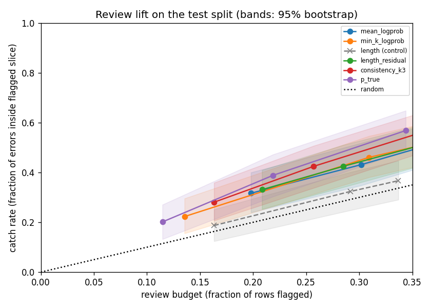
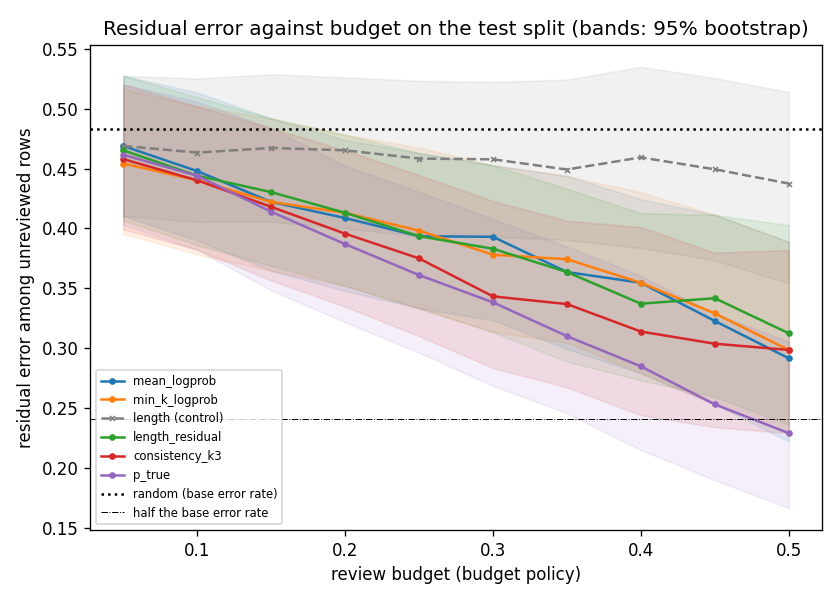
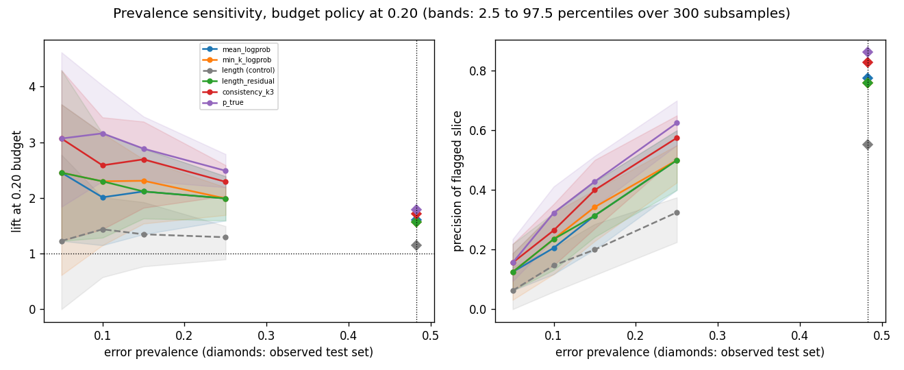
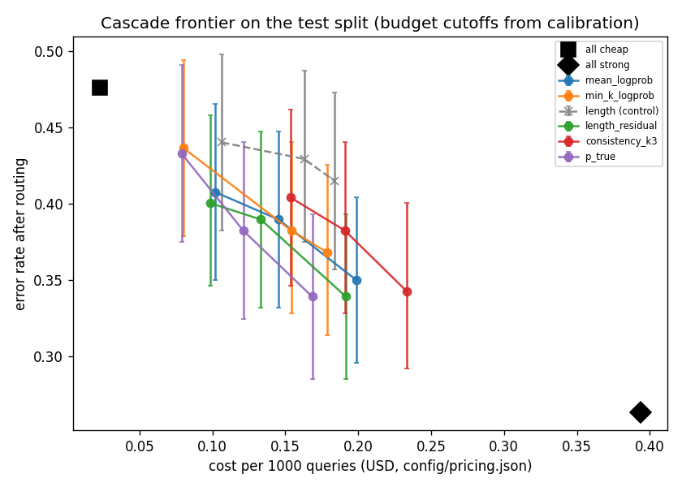

# HalluScope

**A tiered risk-routing layer for model-generated content.** Each model output gets a risk score
from the cheapest scorer the provider supports, with the cost of that score logged. A calibration
function, run per deployment on a small labelled sample, turns the score into a cutoff with a
measured coverage and risk. The layer then routes each output to one of three lanes: return it,
escalate it to a stronger model, or send it to a human. The scorer is replaceable. The calibration
is the product. Every reported number carries an interval and a script that regenerates it. The
`routing/` package is the project; the React frontend and the `backend/app` risk engine are the v1
legacy demo, kept for history, whose numbers were withdrawn after the audit in
[`report1.md`](report1.md).

[](https://github.com/shiv2077/HalluScope/actions/workflows/routing.yml)


Two applications:

- **Review prioritization for model-generated datasets.** Rank rows by risk, spend a fixed review
  budget on the top slice, and report both the errors caught and the residual error rate left in
  the unreviewed remainder.
- **Cheap-to-strong cascades.** Answer with the cheap model, escalate the riskiest fraction to
  the strong model, and report error rate against cost per thousand queries at every cutoff.

## Results

On a 300-question held-out test split with blind two-judge labels (288 rows with a consensus
label). Brackets are 95 percent intervals. Review numbers use the **budget policy**: flag the top
ceil(budget * n) rows of the batch by batch quantile, no calibration input (ADR-018). Cascade
numbers show both the budget policy (circles) and the **risk policy** at fixed cutoffs from the
disjoint 160-row calibration split (triangles). The full tables, the validity gates, the cutoff
drift, the cost tiers and the conditional fix rates are in
[`reports/routing_report.md`](reports/routing_report.md).

| headline | policy | value |
|---|---|---|
| Lift at a 20 percent review budget, best scorer (`p_true`, one extra call, $0.01 per 1000) | budget | 1.79 [1.58, 2.03]: catches 36.0% [31.7, 40.9] of errors against 20.1% [15.9, 25.1] for random |
| Lift at a 20 percent review budget, best free scorer (`mean_logprob`, zero extra calls) | budget | 1.61 [1.38, 1.84] |
| Residual error among unreviewed rows at that budget (`p_true`) | budget | 38.7% [32.2, 45.2], down from 48.3% [42.6, 54.0] with no review |
| Cascade at the best operating point (`p_true`, 30 percent budget) | budget | error 34.7% [29.2, 40.1] at $0.16 [0.13, 0.18] per 1000 queries, against all-cheap 47.7% [41.8, 53.5] at $0.02 and all-strong 26.4% [21.5, 31.8] at $0.39 |

Every scorer beats the `length` control (DeLong p at or below 0.001). A 20 percent cutoff fixed
on the calibration split flagged 30.2% [25.2, 35.7] of test rows for `mean_logprob`, which is why
budget policies take the quantile on the batch. The conformal step returns no risk-controlled
threshold at n=160 for any alpha; the report's required-n table says why.

Precision of the flagged slice at the 20 percent budget, which is what a reviewer sees, is
86.2% [75.1, 92.8] for `p_true` and 77.6% [65.3, 86.4] for `mean_logprob` on a test set whose base
error rate is 48.3%.



Residual error among unreviewed rows falls with budget; `p_true` reaches half the base error rate
only at a 0.50 budget, where residual error is 22.9% [16.7, 30.6].



At production error rates the lift holds but precision falls: at 10 percent prevalence a reviewer
working the `p_true` slice sees precision 32.4% [23.5, 41.2] (subsample intervals over 300
resamples), about 3 rows read per error found against 10 at random.





Regenerate every figure and number from the committed CSVs, CPU only, no keys, about 90 seconds:

```bash
python3 -m routing.cli score --split calibration && python3 -m routing.cli score --split test && python3 -m routing.cli gates && python3 -m routing.cli calibrate && python3 -m routing.cli evaluate
```

## Why routing and not detection

The v1 of this repository shipped a hallucination detector with AUROC 0.785 (API) and 0.918
(local). An audit ([`report1.md`](report1.md)) found that both numbers were contaminated: the
benchmark graded the intervention template instead of the model's answer whenever the risk
score was high, so the top of the ranking was a hallucination by construction. On the answers
that could still be graded, the signal was AUROC 0.64 with a wide interval, and the five-feature
ensemble never beat mean logprob alone. Thresholds, grader cutoffs and normalization constants
had all been chosen on the same rows the results were reported on. A detector that weak cannot
decide correctness, but it can order outputs by risk, and ordering is enough to spend a review
budget or an escalation budget better than random. Routing makes the weak signal useful, keeps
the labels out of the scoring path, and turns the threshold into a per-deployment calibration
instead of a constant in config.

## Architecture

Three layers plus a benchmark harness, and the new `routing/` package beside them:

- **Frontend (React 18 + Vite 5)** — two pages: `ChatPage` (chat UI with an API/Local mode
  picker, per-bubble risk badge, and an intervention banner) and `MetricsPage` (per-message
  dashboard: metric grid, per-token HRI line chart with threshold lines, a token risk heatmap,
  and — local mode only — logit-flatness / RCD trajectory charts).
- **API (FastAPI)** — routers for `POST /chat` + `POST /chat/reset` (chat orchestration with
  per-mode singleton risk services that hold conversation history), `GET /metrics/{message_id}`
  (dashboard lookup), `POST /analyze` (legacy single-shot), and `GET /health`. A background
  thread pre-warms the local model at startup so the first chat doesn't block.
- **Reliability engine** — `metrics/` computes the per-token signals, `risk/hri_engine.py`
  aggregates them into the HRI and classifies the band, and `services/intervention_service.py`
  decides when to suppress an answer and inject a clarification. The scoring core (metrics +
  HRI engine + config loading) is factored into the installable, FastAPI-free
  [`packages/halluscope-core`](packages/halluscope-core) package; `backend/app/{config_store.py,
  metrics/,risk/hri_engine.py}` are backward-compatible shims over it. A SQLite store
  (`backend/app/storage.py`) persists analyzed messages so `/metrics/{id}` survives restarts.

```
                    user prompt
                        │
          ┌─────────────▼─────────────┐
          │   LLM adapter (api|local) │   generate answer, capture per-token
          │   → StandardizedResult    │   logprobs (+ logits & hidden states locally)
          └─────────────┬─────────────┘
                        │
          ┌─────────────▼─────────────┐
          │   metrics/  (per token)   │   logprob variance · confidence decay ·
          │                           │   mean logprob · logit flatness · RCD
          └─────────────┬─────────────┘
                        │
          ┌─────────────▼─────────────┐
          │   risk/hri_engine.py      │   HRI = sigmoid(scale·Σ wᵢ·featureᵢ + bias)
          │   → HRI + LOW/MED/HIGH    │   weights & thresholds from config/*.json
          └─────────────┬─────────────┘
                        │
          ┌─────────────▼─────────────┐
          │  services/intervention    │   HRI ≥ HIGH → suppress answer,
          │                           │   return a clarification request
          └─────────────┬─────────────┘
                        │
                   chat response  (answer or clarification, + full metrics)
```

### Experimental (not validated, not part of HRI)

These signals are implemented and computed on every local-mode turn, but **none of them feed the
HRI score**, none has a validated operating point, and the frontend renders none of them. They
exist to widen the option space for future weight-fitting, not as claims about current detection
quality:

| Signal | Where | Status |
|---|---|---|
| Logit Lens Divergence (LLD) | `metrics/internal_metrics.py::mean_logit_lens_divergence` | Computed (local mode, when per-layer hidden states are captured); surfaced as `mean_lld`; not used by `compute_hri`; not rendered in the UI |
| Confidence-Stability Gap (CSG) | `metrics/internal_metrics.py::mean_confidence_stability_gap` | Computed (local mode); surfaced as `mean_csg`; not used by `compute_hri`; not rendered in the UI |
| Stage 1 prompt risk (`s1`–`s4`: entity rarity, time risk, prompt perplexity, quoted-title) | `metrics/prompt_risk.py::compute_prompt_risk` | Computed pre-generation on every turn; returned in the `prompt_risk` response field; not folded into HRI |
| Stage 3 semantic checks (semantic novelty, entity expansion, claim density) | `metrics/semantic_checks.py::compute_semantic_checks` | Computed post-generation; returned in the `semantic_checks` response field; not folded into HRI |

- **Routing layer (`routing/`)** — the interview build. `data.py` (contract, disjoint splits,
  consensus labels), `generate.py` and `judge.py` (API calls, cost logged), `scorers.py` (six
  scorers, never reads labels), `gates.py` (validity gates), `calibrate.py` (budget and
  risk-controlled cutoffs on calibration only), `evaluate.py` (figures and report on test only),
  `cli.py`. Labels are joined only inside `gates.py` and `evaluate.py`.


## Quickstart

```bash
git clone <repo-url> && cd HalluScope
python3 -m venv .venv && source .venv/bin/activate && pip install -r backend/requirements.txt
cp .env.example .env    # add OPENAI_API_KEY (the only key)
python -m routing.cli run-all          # phases 1 to 3: generate, judge, score, gates, calibrate, evaluate
python -m routing.cli evaluate         # regenerate figures and the report from committed CSVs, CPU, no keys
python -m routing.cli route --policy budget --scorer mean_logprob --budget 0.20 --in answers.csv --out routed.csv
```

`route` takes any CSV with `qid, answer_text, token_logprobs` (a JSON list of per-token logprobs,
plus optional precomputed scorer columns) and adds `policy`, `cutoff_applied` and `lane` columns.
`--policy budget` flags the top ceil(budget * n) rows of the batch and never reads
`results/calibration.json`. `--policy risk` applies a calibrated cutoff for `--scorer` and
`--alpha` from that file and refuses to run if none exists. There is no default threshold
anywhere in this repository.

Individual steps: `build-questions`, `generate --split`, `judge --split [--judge judge_b]`,
`score --split`, `gates`, `calibrate`, `evaluate`, `notes`.

---

## Calibrate on your own data

The number in `results/calibration.json` is not the product. The function that produces it is. To
calibrate on your own model and domain you need two CSVs with disjoint `qid` sets.

**Columns.** For scoring, `data/<split>_generations.csv` with `qid, model, role, answer_text,
token_logprobs, input_tokens, output_tokens, temperature, seed`, where `token_logprobs` is a JSON
list of per-token logprobs and `role` is `primary` (plus `resample_1..3` and `ptrue` rows if you
want the consistency and P(True) scorers). For calibration, `data/<split>_labels.csv` with `qid,
model, judge, verdict, reason`; the consensus rule in `routing/data.py` keeps a row only when both
judges agree. `routing/generate.py` and `routing/judge.py` produce both files from a questions CSV
if you have an OpenAI key.

**Score** (label-free; fits the length regression on the calibration split and stores it):

```bash
python3 -m routing.cli score --split calibration
```

```
wrote /home/shiv2077/dev/HalluScope/data/calibration_scores.csv (162 rows)
```

**Calibrate** (labels joined here only; writes every cutoff with the file hash and n):

```bash
python3 -m routing.cli calibrate
```

```
wrote /home/shiv2077/dev/HalluScope/results/calibration.json (n=160)
```

**What `results/calibration.json` contains**, from the run above:

```
top-level keys: ['budgets', 'calibration_hash', 'labels_hash', 'length_residual', 'n', 'n_ambiguous_excluded', 'positives', 'required_n', 'risk']
budgets mean_logprob: {'0.1': 0.164078, '0.2': 0.12544, '0.3': 0.089767}
risk mean_logprob 0.1: {'reason': 'no threshold has Hoeffding UCB <= 0.1 at delta=0.1 with n=160; see the required_n table', 'threshold': None}
length_residual: {'intercept': 0.0341823918147386, 'n': 162, 'slope': 0.0016691248880968323}
n 160 hash 2071130b013df522
```

`budgets` are the calibration quantiles, kept only to report drift. `risk` holds the Learn-Then-Test
cutoff per scorer and alpha, or `None` with the reason. `required_n` is the table below.

**Reading the required-n table.** For a risk cutoff to pass the Hoeffding test at level alpha with
confidence 1 - delta, the accepted set must hold n_acc = ln(1/delta) / (2 (alpha - risk_hat)^2)
rows, and the calibration set must hold n_acc / coverage rows. With delta 0.10, alpha 0.10 and a
target coverage of 0.70, that is 165 rows if the accepted set had zero empirical errors and 658 rows
if it had 5 percent. Our 160 rows with a 41 percent error rate qualify nothing, which is the honest
result the report shows. Label that many rows before calling a risk cutoff a guarantee.

**Two policies.** `--policy budget` flags the top ceil(budget * n) of the batch you pass in. Use it
when you have a fixed review or escalation budget and a whole batch to rank; it never reads the
calibration file. `--policy risk` applies the calibrated cutoff for `--scorer` and `--alpha`; use it
when the acceptable error rate is fixed and the flag rate may float, and only once the required-n
table says your calibration set is large enough.

```bash
python3 -m routing.cli route --policy budget --scorer mean_logprob --budget 0.20 --in answers.csv --out routed.csv
```

---

## API reference

| Method | Endpoint | Purpose | Key fields |
|---|---|---|---|
| `GET`  | `/health` | Liveness + local-model warmup status | → `status`, `local_model_loaded`, `local_model_name` |
| `POST` | `/chat` | Run one chat turn through the risk pipeline | body: `message`, `evaluation_mode` (`api`\|`local`), optional `temperature`, `seed`, `apply_intervention` → `answer`, `hri`, `risk_level`, `metrics`, `token_details`, `intervention`, `message_id`, `prompt_risk`, `semantic_checks` |
| `POST` | `/chat/reset` | Clear conversation history for both modes | → `status` |
| `GET`  | `/metrics/{message_id}` | Full uncertainty analysis for a past message | → `metrics`, `token_details`, `per_token_hri`, `internal_per_token`, `risk_level` |
| `POST` | `/analyze` | Legacy single-shot analyze (API mode only) | body: `prompt`, `max_tokens`, `temperature` → `answer`, `hri`, `risk_level`, `metrics` |

**Deprecated field alias:** `metrics.mean_semantic_energy` is kept in the `/chat` and
`/metrics/{id}` responses as a deprecated alias of `metrics.mean_logit_flatness` (same value)
so the current frontend, which still reads the old key, does not break. New consumers should
read `mean_logit_flatness`.

Example:

```bash
curl -s http://127.0.0.1:8000/chat \
  -H 'Content-Type: application/json' \
  -d '{"message":"Who won the 2027 Nobel Peace Prize?","evaluation_mode":"api"}'
```

---

## Tech stack

- **Backend** — FastAPI, Python 3.10+, PyTorch 2.2+, HuggingFace Transformers 4.40+, OpenAI
  Python SDK 1.14+, Pydantic 2, SQLite (stdlib).
- **Frontend** — React 18, Vite 5, React Router 6, Recharts 2.
- **Models** — `gpt-4o-mini` (cheap), `gpt-4o` (strong and judge A), `gpt-4.1` (judge B); all OpenAI.
- **Evaluation** — scikit-learn, sentence-transformers, matplotlib, HuggingFace `datasets`.

---

## Project structure

```
HalluScope/
├── backend/
│   ├── requirements.txt
│   └── app/
│       ├── main.py            FastAPI app, startup hooks, /health
│       ├── config.py          env vars + model defaults
│       ├── config_store.py    loads config/*.json (single source of truth)
│       ├── storage.py         SQLite message store
│       ├── api/               chat.py, metrics.py, legacy /analyze
│       ├── adapters/          base · openai · local  (uniform StandardizedResult)
│       ├── metrics/           logprob, confidence-decay, internal-signal metrics
│       ├── risk/hri_engine.py HRI formula + LOW/MED/HIGH classification
│       ├── services/          llm · risk · intervention orchestration
│       └── models/            Pydantic request/response schemas
├── frontend/
│   └── src/
│       ├── api.js             single client for all backend calls
│       ├── pages/             ChatPage, MetricsPage
│       └── components/        ChatWindow, MessageBubble, MetricsPanel,
│                              RiskBadge, TokenHeatmap
├── config/                    weights.json, thresholds.json, norm.json, ...
├── routing/                   risk-routing layer: data, generate, judge, scorers,
│                              gates, calibrate, evaluate, cli
├── eval/                      v1 benchmark harness and eval/audit/ (report1.md)
├── packages/halluscope-core/  scoring core as an installable package (no
│                              FastAPI/SQLite/React); backend/app/{config_store.py,
│                              metrics/,risk/hri_engine.py} are now thin
│                              backward-compatible shims that re-export it
├── tests/                     pytest suite (run: python3 -m pytest)
└── scripts/                   verification / dev scripts, reproduce.sh
```

---

## Limitations

- **Short-answer QA only.** Every number is on HaluEval QA. Long, multi-claim outputs need
  claim-level scoring, which is on the roadmap and not built.
- **OpenAI only for generation.** The logprob scorers need a provider that returns logprobs.
  Consistency and P(True) are text-only and work with any provider, but only OpenAI was run.
- **Two LLM judges from one provider, not humans.** Labels come from two blind OpenAI judges with a consensus rule. Two judges from one provider share failure modes.
  Disagreements are AMBIGUOUS and excluded, and the count is always reported. Human labels on
  a 150-row subsample are the next step.
- **Conformal needs more calibration data.** The Learn-Then-Test function is implemented and
  run, but at n=162 the risk-controlled threshold is reported with its required-n table beside
  it, not as a guarantee.
- **The cascade ceiling is the strong model.** Escalation only helps where the strong model is
  right. The report gives the conditional fix and break rates so that ceiling is visible.

## Further reading

- [`docs/DECISIONS.md`](docs/DECISIONS.md) — architecture decision records: every non-obvious
  choice, the alternatives rejected, and why.
- [`report1.md`](report1.md) — the audit of the v1 numbers.
- [`reports/routing_report.md`](reports/routing_report.md) — the routing evaluation.
- [`ROADMAP.md`](ROADMAP.md) — what is deliberately not built yet.

## Contributing

See [CONTRIBUTING.md](CONTRIBUTING.md). In short: format Python with `ruff`/`black`, keep all
risk constants in `config/*.json` (never hard-code them in the engine), and run
`python3 -m pytest` before opening a PR.

## License

[MIT](LICENSE) © 2026 V Dinessh and Shivnarayan S.

## Authors

- **V Dinessh** — RA2211003011234
- **Shivnarayan S** — RA2211003011216
- **Guide:** Dr. R.I. Minu, Department of Computing Technologies, SRM Institute of Science and Technology
