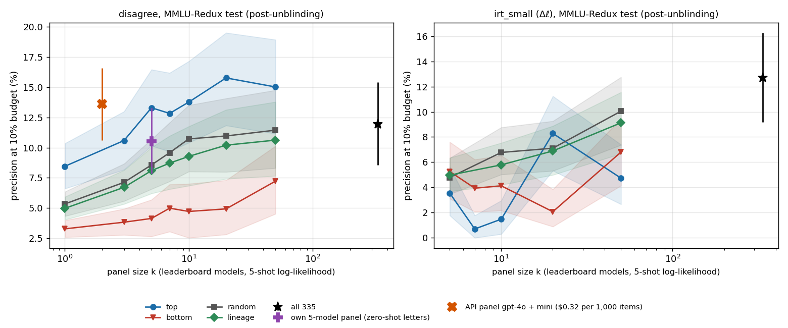

# itemtriage report

Ranks multiple-choice items (question plus answer key) for expert review under a fixed budget, using a small model panel's answers and confidence. Ground truth is MMLU-Redux 2.0 expert annotation. Generated by `python3 -m itemtriage.cli report` from `results/itemtriage/*.json`; regenerate on CPU without API calls.

**Amendment 1 (2 October 2026, before unblinding): the OpenAI key was invalid, so the panel is the five local models and ptrue_key is undefined and dropped (docs/PREREG.md).**

## Verdicts

- **H1a does not hold.** Precision at a 10% budget, primary class: `conf_w` minus `disagree` +1.8 [+0.0, +3.6] points (4.2% of resamples at or below zero); `conf_w` minus `irt_small` +7.7 [+3.6, +11.5] points (0.0% of resamples at or below zero).
- **H1b is not computable.** 21 multiple-choice weak positives outside GPQA in the Writer release, below 100.
- **H2 does not hold.** `lr` plus the probe minus `lr`, precision at 10%: -2.7 [-4.7, -0.6] points (99.8% of resamples at or below zero). The tier is dropped.
- **H3.** Fixed `conf_w` cutoffs from calibration: 5% cutoff flags 6.1% [5.3, 6.9] of test; 10% cutoff flags 12.3% [11.2, 13.4] of test; 20% cutoff flags 27.4% [25.9, 28.9] of test. The budget policy flags exactly the budget. The preregistered risk lane cannot qualify by construction. Under the declared fix, `conf_w` qualifies at alpha 0.1, 0.2, where the base rate is already below alpha; see H3 below.

## Panel

| model | ability θ | weight in `conf_w` |
|---|---:|---:|
| `qwen2.5-3b` | 0.700 | 0.257 |
| `qwen2.5-1.5b` | 0.044 | 0.134 |
| `phi-3.5-mini` | 1.393 | 0.515 |
| `smollm2-1.7b` | -1.449 | 0.030 |
| `granite-3.1-2b` | -0.687 | 0.064 |

IRT variant carried forward: `irt_small`, chosen on validation average precision (`irt_small` 0.077, `irt_small_c` 0.071). `lr` used C = 10.0, fit on 1691 calibration items.

## Primary class: ground-truth errors (test, 3380 known items, 117 positives, base rate 3.5% [2.9, 4.1])

20 test items marked `expert` are excluded.

| scorer | precision at 5% | precision at 10% | precision at 20% | recall at 10% | lift at 10% | AP | AUROC |
|---|---|---|---|---|---|---|---|
| `conf_w` | 19.5% [13.0, 26.6] | 13.0% [9.5, 16.9] | 8.7% [6.8, 10.9] | 37.6% [28.9, 45.3] | 3.76 [2.89, 4.53] | 0.190 [0.123, 0.268] | 0.737 [0.690, 0.781] |
| `conf` | 18.9% [13.0, 25.4] | 11.8% [8.6, 15.4] | 9.0% [7.0, 11.4] | 34.2% [25.8, 42.0] | 3.42 [2.58, 4.20] | 0.179 [0.115, 0.253] | 0.729 [0.679, 0.776] |
| `disagree` | 18.3% [13.0, 24.9] | 11.2% [8.0, 14.8] | 9.5% [7.4, 11.8] | 32.5% [24.2, 40.8] | 3.25 [2.42, 4.08] | 0.177 [0.115, 0.251] | 0.729 [0.677, 0.776] |
| `irt_small` | 7.7% [3.6, 11.8] | 5.3% [3.3, 8.0] | 5.6% [3.7, 8.1] | 15.4% [9.3, 22.5] | 1.54 [0.93, 2.25] | 0.057 [0.045, 0.074] | 0.659 [0.607, 0.706] |
| `lr` | 16.6% [11.8, 23.7] | 12.4% [8.9, 16.0] | 8.0% [6.1, 10.1] | 35.9% [27.4, 43.9] | 3.59 [2.74, 4.39] | 0.126 [0.083, 0.184] | 0.693 [0.641, 0.744] |
| `length` | 7.1% [3.6, 11.2] | 5.6% [3.3, 8.3] | 3.6% [2.2, 4.9] | 16.2% [10.2, 22.8] | 1.62 [1.02, 2.28] | 0.051 [0.031, 0.083] | 0.471 [0.414, 0.528] |
| `dup_options` | 3.6% [1.2, 6.5] | 3.6% [1.5, 5.6] | 2.4% [1.3, 3.6] | 10.3% [4.7, 15.8] | 1.03 [0.47, 1.58] | 0.035 [0.027, 0.050] | 0.488 [0.439, 0.539] |
| best possible | 69.2% | 34.6% | 17.3% | | | 1.000 | 1.000 |

## Secondary class: any flaw (test, 3380 known items, 216 positives, base rate 6.4% [5.6, 7.3])

| scorer | precision at 5% | precision at 10% | precision at 20% | recall at 10% | lift at 10% | AP | AUROC |
|---|---|---|---|---|---|---|---|
| `conf_w` | 24.9% [18.3, 32.5] | 18.6% [14.5, 22.8] | 14.3% [11.8, 17.0] | 29.2% [23.6, 34.8] | 2.92 [2.36, 3.48] | 0.203 [0.155, 0.259] | 0.711 [0.675, 0.747] |
| `conf` | 24.9% [18.3, 31.4] | 17.5% [13.3, 21.6] | 14.8% [12.1, 17.5] | 27.3% [22.0, 32.8] | 2.73 [2.20, 3.28] | 0.193 [0.147, 0.246] | 0.707 [0.671, 0.743] |
| `disagree` | 24.3% [17.8, 31.4] | 17.2% [13.3, 21.6] | 15.4% [12.7, 18.2] | 26.9% [21.5, 32.6] | 2.69 [2.15, 3.26] | 0.193 [0.148, 0.247] | 0.708 [0.670, 0.745] |
| `irt_small` | 11.2% [5.9, 16.0] | 8.9% [5.9, 12.4] | 8.9% [6.7, 12.1] | 13.9% [9.6, 18.8] | 1.39 [0.96, 1.88] | 0.091 [0.076, 0.109] | 0.622 [0.582, 0.661] |
| `lr` | 22.5% [17.2, 29.6] | 18.9% [14.5, 23.1] | 13.2% [10.7, 15.8] | 29.6% [23.8, 34.8] | 2.96 [2.38, 3.48] | 0.154 [0.121, 0.197] | 0.683 [0.646, 0.719] |
| `length` | 10.1% [5.9, 14.8] | 7.4% [4.7, 10.4] | 5.5% [3.7, 7.2] | 11.6% [7.5, 15.8] | 1.16 [0.75, 1.58] | 0.075 [0.056, 0.099] | 0.448 [0.409, 0.490] |
| `dup_options` | 7.1% [3.6, 11.8] | 6.5% [3.8, 9.2] | 5.2% [3.7, 7.0] | 10.2% [6.2, 14.0] | 1.02 [0.62, 1.40] | 0.064 [0.053, 0.080] | 0.483 [0.443, 0.525] |
| best possible | 100.0% | 63.9% | 32.0% | | | 1.000 | 1.000 |

## Exploratory: virology excluded (primary class, 3280 items, 76 positives)

| scorer | precision at 5% | precision at 10% | precision at 20% | recall at 10% | lift at 10% | AP | AUROC |
|---|---|---|---|---|---|---|---|
| `conf_w` | 7.3% [3.7, 11.6] | 5.8% [3.4, 8.5] | 4.6% [2.9, 6.2] | 25.0% [15.8, 35.0] | 2.50 [1.58, 3.50] | 0.077 [0.039, 0.134] | 0.668 [0.608, 0.725] |
| `conf` | 7.3% [3.7, 11.6] | 4.9% [2.7, 7.3] | 4.3% [2.7, 5.9] | 21.1% [12.5, 31.0] | 2.11 [1.25, 3.10] | 0.073 [0.037, 0.127] | 0.660 [0.598, 0.720] |
| `disagree` | 6.7% [3.0, 11.0] | 4.6% [2.4, 7.0] | 4.7% [3.2, 6.6] | 19.7% [11.1, 29.2] | 1.97 [1.11, 2.92] | 0.073 [0.037, 0.126] | 0.661 [0.599, 0.721] |
| `irt_small` | 6.7% [3.0, 10.4] | 4.6% [2.4, 7.0] | 4.1% [2.6, 5.6] | 19.7% [11.1, 28.6] | 1.97 [1.11, 2.86] | 0.038 [0.027, 0.055] | 0.620 [0.552, 0.683] |
| `lr` | 7.9% [3.0, 11.6] | 5.2% [2.7, 7.9] | 3.5% [2.1, 4.9] | 22.4% [13.3, 31.8] | 2.24 [1.33, 3.18] | 0.055 [0.028, 0.096] | 0.607 [0.543, 0.674] |
| `length` | 7.3% [3.7, 11.0] | 5.2% [2.7, 7.6] | 3.0% [1.8, 4.4] | 22.4% [13.2, 31.6] | 2.24 [1.32, 3.16] | 0.054 [0.026, 0.100] | 0.510 [0.435, 0.586] |
| `dup_options` | 3.0% [0.6, 6.1] | 3.0% [1.2, 4.9] | 1.8% [0.9, 2.9] | 13.2% [5.7, 20.5] | 1.32 [0.57, 2.05] | 0.027 [0.019, 0.048] | 0.523 [0.465, 0.587] |
| best possible | 46.3% | 23.2% | 11.6% | | | 1.000 | 1.000 |

Paired differences at 10%: `conf_w-disagree` +1.2 [+0.0, +2.7] points (5.7% of resamples at or below zero); `conf_w-irt_small` +1.2 [-1.5, +4.3] points (22.3% of resamples at or below zero).

## Cost per error found (primary class)

API dollars come from logged tokens and `config/pricing.json`. Local models cost $0. Reviewer minutes assume 2 minutes per reviewed item, which is an assumption, not a measurement.

| scorer | API $ per item | errors found at 10% | API $ per error at 10% | assumed reviewer minutes per error at 10% |
|---|---:|---|---|---|
| `conf_w` | 0.00000 | 44.0 [32.0, 57.0] | 0.000 [0.000, 0.000] | 15.4 [11.9, 21.1] |
| `conf` | 0.00000 | 40.0 [29.0, 52.0] | 0.000 [0.000, 0.000] | 16.9 [13.0, 23.3] |
| `disagree` | 0.00000 | 38.0 [27.0, 50.0] | 0.000 [0.000, 0.000] | 17.8 [13.5, 25.0] |
| `irt_small` | 0.00000 | 18.0 [11.0, 27.0] | 0.000 [0.000, 0.000] | 37.6 [25.0, 61.5] |
| `lr` | 0.00000 | 42.0 [30.0, 54.0] | 0.000 [0.000, 0.000] | 16.1 [12.5, 22.5] |
| `length` | 0.00000 | 19.0 [11.0, 28.0] | 0.000 [0.000, 0.000] | 35.6 [24.1, 61.5] |
| `dup_options` | 0.00000 | 12.0 [5.0, 19.0] | 0.000 [0.000, 0.000] | 56.3 [35.6, 135.2] |

## Exploratory: agreement with the key, flawed versus ok calibration items

A model that agrees with wrong keys as often as with right ones may have memorized them.

| model | agrees with key on flawed items | agrees with key on ok items |
|---|---|---|
| `granite-3.1-2b` | 18.8% [11.1, 30.0] | 59.3% [57.3, 61.3] |
| `phi-3.5-mini` | 35.9% [25.3, 48.2] | 74.2% [72.3, 76.0] |
| `qwen2.5-1.5b` | 26.6% [17.3, 38.5] | 66.5% [64.5, 68.4] |
| `qwen2.5-3b` | 28.1% [18.6, 40.1] | 70.5% [68.5, 72.3] |
| `smollm2-1.7b` | 31.2% [21.2, 43.4] | 55.2% [53.1, 57.2] |


## Exploratory, post-unblinding: bad items or bad subjects?

Exploratory, post-unblinding. No decision rule. Splits are by subject, so a high score could only mean "this item is in a bad subject". `subject_mean` gives every item the mean `conf_w` of its subject. It has no secondary key, so ties inside a subject resolve in expectation. `within_subject` is `conf_w` minus `subject_mean`. Both are label-free. Primary class, test fold.

**All test items** (3380 items, 117 positives).

| scorer | precision at 5% | precision at 10% | precision at 20% | recall at 10% | lift at 10% | AP | AUROC |
|---|---|---|---|---|---|---|---|
| `conf_w` | 19.5% [13.0, 26.6] | 13.0% [9.5, 16.9] | 8.7% [6.8, 10.9] | 37.6% [28.9, 45.3] | 3.76 [2.89, 4.53] | 0.190 [0.123, 0.268] | 0.737 [0.690, 0.781] |
| `subject_mean` | 0.0% [0.0, 0.0] | 0.3% [0.0, 0.9] | 8.4% [6.4, 10.7] | 1.0% [0.0, 2.7] | 0.10 [0.00, 0.27] | 0.055 [0.043, 0.068] | 0.656 [0.607, 0.705] |
| `within_subject` | 6.5% [2.4, 10.1] | 4.4% [2.4, 7.1] | 8.0% [6.1, 10.1] | 12.8% [7.3, 19.8] | 1.28 [0.73, 1.98] | 0.065 [0.050, 0.085] | 0.686 [0.636, 0.734] |
| `disagree` | 18.3% [13.0, 24.9] | 11.2% [8.0, 14.8] | 9.5% [7.4, 11.8] | 32.5% [24.2, 40.8] | 3.25 [2.42, 4.08] | 0.177 [0.115, 0.251] | 0.729 [0.677, 0.776] |
| `length` | 7.1% [3.6, 11.2] | 5.6% [3.3, 8.3] | 3.6% [2.2, 4.9] | 16.2% [10.2, 22.8] | 1.62 [1.02, 2.28] | 0.051 [0.031, 0.083] | 0.471 [0.414, 0.528] |
| best possible | 69.2% | 34.6% | 17.3% | | | 1.000 | 1.000 |

Paired differences at 10%: `conf_w-subject_mean` +12.7 [+9.1, +16.3] points (0.0% of resamples at or below zero), `within_subject-length` -1.2 [-4.4, +2.4] points (74.9% of resamples at or below zero).

**Virology excluded** (3280 items, 76 positives).

| scorer | precision at 5% | precision at 10% | precision at 20% | recall at 10% | lift at 10% | AP | AUROC |
|---|---|---|---|---|---|---|---|
| `conf_w` | 7.3% [3.7, 11.6] | 5.8% [3.4, 8.5] | 4.6% [2.9, 6.2] | 25.0% [15.8, 35.0] | 2.50 [1.58, 3.50] | 0.077 [0.039, 0.134] | 0.668 [0.608, 0.725] |
| `subject_mean` | 0.0% [0.0, 0.0] | 0.3% [0.0, 0.8] | 2.7% [1.6, 3.9] | 1.1% [0.0, 3.4] | 0.11 [0.00, 0.34] | 0.027 [0.021, 0.035] | 0.562 [0.492, 0.627] |
| `within_subject` | 6.1% [2.4, 10.4] | 4.6% [2.4, 7.0] | 4.4% [2.7, 6.1] | 19.7% [11.1, 28.9] | 1.97 [1.11, 2.89] | 0.044 [0.030, 0.068] | 0.647 [0.581, 0.711] |
| `disagree` | 6.7% [3.0, 11.0] | 4.6% [2.4, 7.0] | 4.7% [3.2, 6.6] | 19.7% [11.1, 29.2] | 1.97 [1.11, 2.92] | 0.073 [0.037, 0.126] | 0.661 [0.599, 0.721] |
| `length` | 7.3% [3.7, 11.0] | 5.2% [2.7, 7.6] | 3.0% [1.8, 4.4] | 22.4% [13.2, 31.6] | 2.24 [1.32, 3.16] | 0.054 [0.026, 0.100] | 0.510 [0.435, 0.586] |
| best possible | 46.3% | 23.2% | 11.6% | | | 1.000 | 1.000 |

Paired differences at 10%: `conf_w-subject_mean` +5.5 [+3.2, +8.3] points (0.0% of resamples at or below zero), `within_subject-length` -0.6 [-4.0, +2.7] points (66.0% of resamples at or below zero).

**Per subject, at a 10% budget.** Recall with a Wilson interval. Flagged is the expected number of the subject's items in the flagged slice. 16 of 34 test subjects have no positives.

| subject | items | positives | `conf_w` recall (flagged) | `subject_mean` recall (flagged) | `within_subject` recall (flagged) | `disagree` recall (flagged) | `length` recall (flagged) |
|---|---:|---:|---|---|---|---|---|
| virology | 100 | 41 | 61% [46, 74] (34) | 0% [0, 9] (0) | 0% [0, 9] (0) | 56% [41, 70] (29) | 5% [1, 16] (4) |
| professional_law | 100 | 13 | 15% [4, 42] (17) | 0% [0, 23] (0) | 0% [0, 23] (0) | 23% [8, 50] (15) | 100% [77, 100] (94) |
| formal_logic | 100 | 12 | 17% [5, 45] (11) | 0% [0, 24] (0) | 0% [0, 24] (5) | 8% [1, 35] (12) | 17% [5, 45] (14) |
| logical_fallacies | 100 | 10 | 0% [0, 28] (0) | 0% [0, 28] (0) | 0% [0, 28] (11) | 0% [0, 28] (1) | 0% [0, 28] (8) |
| public_relations | 100 | 6 | 17% [3, 56] (11) | 0% [0, 39] (0) | 33% [10, 70] (18) | 17% [3, 56] (7) | 0% [0, 39] (6) |
| conceptual_physics | 97 | 5 | 40% [12, 77] (10) | 0% [0, 43] (0) | 60% [23, 88] (15) | 40% [12, 77] (14) | 0% [0, 43] (0) |
| international_law | 100 | 5 | 20% [4, 62] (6) | 0% [0, 43] (0) | 40% [12, 77] (14) | 0% [0, 43] (7) | 40% [12, 77] (17) |
| professional_accounting | 98 | 5 | 0% [0, 43] (13) | 0% [0, 43] (0) | 0% [0, 43] (13) | 0% [0, 43] (14) | 0% [0, 43] (19) |
| college_computer_science | 100 | 3 | 0% [0, 56] (11) | 0% [0, 56] (0) | 0% [0, 56] (3) | 0% [0, 56] (9) | 0% [0, 56] (20) |
| computer_security | 100 | 3 | 100% [44, 100] (6) | 0% [0, 56] (0) | 100% [44, 100] (14) | 67% [21, 94] (7) | 0% [0, 56] (6) |
| high_school_physics | 100 | 3 | 67% [21, 94] (22) | 38% [8, 82] (38) | 0% [0, 56] (0) | 0% [0, 56] (17) | 0% [0, 56] (18) |
| machine_learning | 100 | 3 | 33% [6, 79] (16) | 0% [0, 56] (0) | 0% [0, 56] (0) | 33% [6, 79] (11) | 0% [0, 56] (4) |
| astronomy | 100 | 2 | 50% [9, 91] (6) | 0% [0, 66] (0) | 50% [9, 91] (15) | 50% [9, 91] (5) | 0% [0, 66] (8) |
| elementary_mathematics | 100 | 2 | 50% [9, 91] (11) | 0% [0, 66] (0) | 50% [9, 91] (10) | 50% [9, 91] (14) | 0% [0, 66] (2) |
| anatomy | 100 | 1 | 100% [21, 100] (17) | 0% [0, 79] (0) | 100% [21, 100] (20) | 100% [21, 100] (15) | 0% [0, 79] (1) |
| electrical_engineering | 100 | 1 | 0% [0, 79] (8) | 0% [0, 79] (0) | 0% [0, 79] (9) | 0% [0, 79] (9) | 0% [0, 79] (0) |
| high_school_microeconomics | 100 | 1 | 100% [21, 100] (4) | 0% [0, 79] (0) | 100% [21, 100] (11) | 100% [21, 100] (3) | 0% [0, 79] (4) |
| moral_disputes | 100 | 1 | 100% [21, 100] (12) | 0% [0, 79] (0) | 100% [21, 100] (17) | 100% [21, 100] (12) | 0% [0, 79] (3) |
| 16 subjects with no positives | 1585 | 0 | (123) | (300) | (163) | (137) | (110) |

**Memorization, test fold.** Share of items where each model's answer equals the key, with Wilson intervals. Chance is 25% on four options.

| model | flawed items | ok items |
|---|---|---|
| `granite-3.1-2b` | 29.9% [22.4, 38.7] | 52.3% [50.6, 54.1] |
| `phi-3.5-mini` | 31.6% [23.9, 40.5] | 66.4% [64.7, 68.0] |
| `qwen2.5-1.5b` | 31.6% [23.9, 40.5] | 60.7% [59.1, 62.4] |
| `qwen2.5-3b` | 29.9% [22.4, 38.7] | 63.1% [61.5, 64.8] |
| `smollm2-1.7b` | 30.8% [23.1, 39.6] | 49.1% [47.4, 50.8] |

## Exploratory, post-unblinding: Study 1 with its preregistered API models

Exploratory, post-unblinding: the API models ran on 24 November 2026, after the test fold was unblinded. The seven-model panel is the one PREREG named before Amendment 1: `gpt-4o`, `gpt-4o-mini`, `qwen2.5-3b`, `qwen2.5-1.5b`, `phi-3.5-mini`, `smollm2-1.7b`, `granite-3.1-2b`. Same test set (3380 items, 117 primary positives), same scorers, tie keys and bootstrap indices as H1. `ptrue_key` is restored.

**Seven-model panel.**

| scorer | precision at 5% | precision at 10% | precision at 20% | recall at 10% | lift at 10% | AP | AUROC |
|---|---|---|---|---|---|---|---|
| `conf_w` | 26.6% [20.1, 34.3] | 16.9% [13.0, 21.3] | 10.2% [8.0, 12.7] | 48.7% [40.2, 57.5] | 4.87 [4.02, 5.75] | 0.262 [0.183, 0.346] | 0.776 [0.728, 0.822] |
| `conf` | 24.9% [18.9, 32.0] | 16.3% [12.4, 20.4] | 9.8% [7.5, 12.1] | 47.0% [38.3, 55.7] | 4.70 [3.83, 5.57] | 0.239 [0.164, 0.319] | 0.757 [0.708, 0.806] |
| `disagree` | 22.5% [16.6, 29.6] | 16.3% [12.4, 20.7] | 9.5% [7.4, 12.0] | 47.0% [38.0, 55.9] | 4.70 [3.80, 5.59] | 0.235 [0.161, 0.315] | 0.758 [0.707, 0.806] |
| `irt_small` | 6.5% [3.0, 10.1] | 7.7% [5.3, 11.2] | 10.7% [8.3, 13.3] | 22.2% [15.8, 31.0] | 2.22 [1.58, 3.10] | 0.075 [0.058, 0.099] | 0.699 [0.643, 0.752] |
| `ptrue_key` | 29.0% [21.3, 36.7] | 16.3% [12.4, 20.7] | 10.2% [8.0, 12.6] | 47.0% [38.5, 55.9] | 4.70 [3.85, 5.59] | 0.338 [0.248, 0.430] | 0.792 [0.749, 0.834] |
| `length` | 7.1% [3.6, 11.2] | 5.6% [3.3, 8.3] | 3.6% [2.2, 4.9] | 16.2% [10.2, 22.8] | 1.62 [1.02, 2.28] | 0.051 [0.031, 0.083] | 0.471 [0.414, 0.529] |
| best possible | 69.2% | 34.6% | 17.3% | | | 1.000 | 1.000 |

Paired differences at 10%: `conf_w-disagree` +0.6 [-0.9, +2.4] points (27.5% of resamples at or below zero), `conf_w-irt_small` +9.2 [+5.0, +12.7] points (0.0% of resamples at or below zero), `ptrue_key-conf_w` -0.6 [-3.3, +2.1] points (70.4% of resamples at or below zero).

**Two-model API panel** (`gpt-4o`, `gpt-4o-mini`).

| scorer | precision at 5% | precision at 10% | precision at 20% | recall at 10% | lift at 10% | AP | AUROC |
|---|---|---|---|---|---|---|---|
| `conf` | 31.4% [23.7, 39.6] | 17.8% [13.6, 22.2] | 10.2% [8.0, 12.7] | 51.3% [42.3, 60.3] | 5.13 [4.23, 6.03] | 0.302 [0.221, 0.401] | 0.799 [0.757, 0.840] |
| `disagree` | 31.4% [23.7, 39.6] | 17.8% [13.6, 22.2] | 10.2% [8.0, 12.7] | 51.3% [42.3, 60.3] | 5.13 [4.23, 6.03] | 0.302 [0.221, 0.401] | 0.799 [0.757, 0.840] |
| `ptrue_key` | 29.0% [21.3, 36.7] | 16.3% [12.4, 20.7] | 10.2% [8.0, 12.6] | 47.0% [38.5, 55.9] | 4.70 [3.85, 5.59] | 0.338 [0.248, 0.430] | 0.792 [0.749, 0.834] |
| best possible | 69.2% | 34.6% | 17.3% | | | 1.000 | 1.000 |

Paired difference at 10%: `conf-disagree` +0.0 [+0.0, +0.0] points (100.0% of resamples at or below zero).

Logged cost per 1,000 items (prices from `config/pricing.json`):

| model and call | calls | USD per 1,000 items |
|---|---:|---:|
| gpt-4o-mini:mc | 5700 | 0.018 |
| gpt-4o-mini:ptrue | 5700 | 0.022 |
| gpt-4o:mc | 5700 | 0.305 |
| gpt-4o:ptrue | 5700 | 0.362 |

Letter calls for both API models together: $0.32 per 1,000 items.

## Study 2: panel size and strength

Preregistered in `docs/PREREG_2.md` (commit `069ffd71`) before any Study 2 metric. Panels are drawn from 335 Open LLM Leaderboard models (one per 95% agreement cluster, 5-shot log-likelihood regime). MMLU-Redux results are exploratory and post-unblinding (PREREG_2). Platinum GSM8K is the blind confirmatory test of H4. MMLU-Redux test: 3375 matched items, 117 primary positives. Random and lineage-diverse cells average 50 panel draws, IRT cells 20. Intervals are a nested bootstrap, items outer and draws inner. `conf` and `conf_w` use 321 models with per-choice log-likelihoods.

### Verdicts

- **H4 on platinum GSM8K (confirmatory): inconclusive.** Top-3 minus random-10, `disagree`, precision at 10% (30 of 300 items flagged, 33 positives): -0.2 [-5.5, +5.6] points (53.1% of resamples at or below zero).
- **H4 on MMLU-Redux (exploratory): inconclusive.** Same contrast: -0.1 [-1.9, +1.5] points (55.5% of resamples at or below zero).
- **H5.** No panel size in range keeps the random-k lower bound at or above 80% of the all-model estimate (12.0%, target 9.6%).
- **H6, `irt_small`.** No crossing in range. Paired differences: k = 5 -3.9 [-6.0, -1.9] points (100.0% of resamples at or below zero), k = 10 -3.8 [-6.4, -1.2] points (99.7% of resamples at or below zero), k = 20 -3.4 [-6.1, -0.7] points (99.5% of resamples at or below zero), k = 50 -1.4 [-4.2, +1.4] points (84.8% of resamples at or below zero), k = 335 +0.8 [-2.4, +4.1] points (34.8% of resamples at or below zero).
- **H6, `item_total`.** No crossing in range. Paired differences: k = 5 -3.9 [-5.9, -2.1] points (100.0% of resamples at or below zero), k = 10 -5.2 [-7.8, -2.8] points (100.0% of resamples at or below zero), k = 20 -4.1 [-6.8, -1.5] points (100.0% of resamples at or below zero), k = 50 -2.3 [-5.0, +0.4] points (95.7% of resamples at or below zero), k = 335 -1.0 [-4.0, +2.8] points (67.3% of resamples at or below zero).

### Precision at 10% by panel strength and size (`disagree`)

| stratum | k = 1 | k = 3 | k = 5 | k = 7 | k = 10 | k = 20 | k = 50 |
|---|---|---|---|---|---|---|---|
| top | 8.5% [6.6, 10.4] | 10.6% [8.2, 13.0] | 13.3% [10.1, 16.5] | 12.8% [9.7, 16.2] | 13.8% [10.4, 17.2] | 15.8% [11.8, 19.5] | 15.0% [11.2, 18.9] |
| bottom | 3.3% [2.6, 4.0] | 3.8% [2.8, 4.9] | 4.1% [2.7, 5.7] | 5.0% [3.1, 7.0] | 4.7% [2.5, 7.0] | 4.9% [2.8, 7.3] | 7.2% [4.5, 10.1] |
| random | 5.3% [4.3, 6.4] | 7.1% [5.6, 8.7] | 8.6% [6.6, 10.7] | 9.6% [7.2, 12.1] | 10.7% [8.0, 13.5] | 11.0% [8.0, 14.1] | 11.4% [8.3, 14.8] |
| lineage | 5.0% [4.0, 5.9] | 6.7% [5.3, 8.1] | 8.1% [6.2, 10.0] | 8.7% [6.6, 11.0] | 9.3% [6.8, 11.8] | 10.2% [7.4, 13.1] | 10.6% [7.7, 13.8] |

All 335 models: 12.0% [8.6, 15.4]. `length` control: 5.6% [3.3, 8.3]. Own five-model local panel, zero-shot, direct letters, own run (Study 1): `disagree` 10.5% [7.9, 13.3], `conf_w` 13.0% [9.2, 16.6].

### Precision at 10% by scorer, random panels

| scorer | k = 1 | k = 3 | k = 5 | k = 7 | k = 10 | k = 20 | k = 50 | all 335 |
|---|---|---|---|---|---|---|---|---|
| `disagree` | 5.3% [4.3, 6.4] | 7.1% [5.6, 8.7] | 8.6% [6.6, 10.7] | 9.6% [7.2, 12.1] | 10.7% [8.0, 13.5] | 11.0% [8.0, 14.1] | 11.4% [8.3, 14.8] | 12.0% [8.6, 15.4] |
| `strong3` | 5.3% [4.3, 6.4] | 7.1% [5.6, 8.7] | 7.8% [6.1, 9.6] | 8.0% [6.3, 9.9] | 8.7% [6.8, 10.6] | 9.1% [7.0, 11.3] | 10.3% [8.0, 12.8] | 10.6% [8.2, 13.0] |
| `item_total` |  |  | 4.6% [3.5, 5.9] | 5.1% [3.8, 6.5] | 5.5% [4.1, 7.0] | 6.9% [5.1, 8.8] | 9.1% [6.7, 11.7] | 10.9% [8.0, 14.8] |
| `irt_small` |  |  | 4.8% [3.5, 6.3] |  | 6.8% [5.0, 8.8] | 7.1% [5.3, 9.3] | 10.0% [7.4, 12.8] | 12.7% [9.2, 16.3] |
| `subject_mean` | 1.7% [1.0, 2.6] | 0.7% [0.3, 1.2] | 0.6% [0.2, 1.2] | 0.5% [0.1, 1.0] | 0.3% [0.0, 0.7] | 0.3% [0.0, 0.8] | 0.3% [0.0, 0.7] | 0.0% [0.0, 0.0] |
| `conf` | 10.9% [8.2, 13.9] | 11.5% [8.6, 14.7] | 12.1% [8.9, 15.3] | 12.2% [9.1, 15.6] | 12.7% [9.4, 16.2] | 12.6% [9.3, 16.1] | 13.0% [9.4, 16.6] | 13.6% [9.8, 17.5] |
| `conf_w` |  |  | 13.2% [9.8, 16.8] |  | 13.4% [10.0, 17.0] | 12.8% [9.4, 16.3] | 13.6% [10.0, 17.2] | 14.5% [10.7, 18.0] |

### Same, top-k panels

| scorer | k = 1 | k = 3 | k = 5 | k = 7 | k = 10 | k = 20 | k = 50 |
|---|---|---|---|---|---|---|---|
| `disagree` | 8.5% [6.6, 10.4] | 10.6% [8.2, 13.0] | 13.3% [10.1, 16.5] | 12.8% [9.7, 16.2] | 13.8% [10.4, 17.2] | 15.8% [11.8, 19.5] | 15.0% [11.2, 18.9] |
| `strong3` | 8.5% [6.6, 10.4] | 10.6% [8.2, 13.0] | 10.6% [8.2, 13.0] | 10.6% [8.2, 13.0] | 10.6% [8.2, 13.0] | 10.6% [8.2, 13.0] | 10.6% [8.2, 13.0] |
| `item_total` |  |  | 3.3% [1.5, 5.3] | 3.3% [1.5, 5.3] | 3.0% [1.2, 5.0] | 3.6% [1.8, 5.6] | 4.1% [2.4, 6.5] |
| `irt_small` |  |  | 3.6% [1.8, 5.6] | 0.7% [0.0, 1.8] | 1.5% [0.3, 3.0] | 8.3% [5.3, 11.2] | 4.7% [2.7, 7.4] |
| `conf` | 17.5% [13.6, 21.6] | 17.2% [13.0, 21.3] | 16.9% [12.7, 21.0] | 15.4% [11.5, 19.2] | 16.3% [12.1, 20.1] | 16.0% [12.1, 20.1] | 14.5% [10.7, 18.6] |
| `conf_w` |  |  | 16.9% [13.0, 21.0] | 10.9% [7.7, 14.5] | 13.6% [10.1, 17.5] | 16.9% [12.7, 21.3] | 15.1% [11.2, 19.2] |

### Precision at 10%, virology excluded

| scorer | top-3 | random-10 | random-50 | all-335 | `length` |
|---|---|---|---|---|---|
| `disagree` | 5.1% [3.3, 7.0] | 4.5% [2.9, 6.3] | 4.5% [2.6, 6.7] | 4.9% [2.7, 7.1] | 5.2% [2.7, 7.6] |
| `strong3` | 5.1% [3.3, 7.0] | 4.2% [2.9, 5.7] | 5.0% [3.3, 6.8] | 5.1% [3.3, 7.0] | 5.2% [2.7, 7.6] |
| `item_total` |  | 3.6% [2.4, 4.8] | 5.4% [3.5, 7.6] | 6.7% [4.3, 9.8] | 5.2% [2.7, 7.6] |
| `irt_small` |  | 4.4% [3.0, 6.1] | 5.6% [3.5, 7.8] | 6.7% [4.3, 9.5] | 5.2% [2.7, 7.6] |
| `subject_mean` | 0.9% [0.0, 2.1] | 0.3% [0.0, 0.6] | 0.2% [0.0, 0.6] | 0.0% [0.0, 0.0] | 5.2% [2.7, 7.6] |
| `conf` | 7.6% [4.9, 10.7] | 5.1% [3.1, 7.2] | 4.9% [2.9, 7.2] | 4.9% [2.7, 7.3] | 5.2% [2.7, 7.6] |
| `conf_w` |  | 5.4% [3.3, 7.8] | 5.4% [3.2, 7.7] | 6.7% [3.7, 9.1] | 5.2% [2.7, 7.6] |

### Precision at 10%, secondary class (any flaw)

| scorer | top-3 | random-10 | random-50 | all-335 | `length` |
|---|---|---|---|---|---|
| `disagree` | 15.5% [12.6, 18.4] | 16.3% [12.9, 19.5] | 17.5% [13.7, 21.5] | 18.2% [14.1, 22.6] | 7.4% [4.7, 10.4] |
| `strong3` | 15.5% [12.6, 18.4] | 13.6% [11.3, 15.9] | 15.5% [12.7, 18.4] | 15.5% [12.6, 18.4] | 7.4% [4.7, 10.4] |
| `item_total` |  | 9.3% [7.6, 11.1] | 13.4% [10.7, 16.2] | 15.4% [11.8, 19.2] | 7.4% [4.7, 10.4] |
| `irt_small` |  | 10.7% [8.6, 13.0] | 14.4% [11.3, 17.2] | 15.7% [12.1, 19.5] | 7.4% [4.7, 10.4] |
| `subject_mean` | 17.5% [13.2, 21.7] | 1.1% [0.4, 2.1] | 1.1% [0.3, 2.2] | 1.0% [0.1, 2.1] | 7.4% [4.7, 10.4] |
| `conf` | 21.3% [17.2, 26.3] | 18.4% [14.6, 22.4] | 18.6% [14.4, 22.7] | 19.8% [15.1, 24.3] | 7.4% [4.7, 10.4] |
| `conf_w` |  | 19.0% [15.2, 23.2] | 19.2% [15.0, 23.4] | 20.1% [15.4, 24.3] | 7.4% [4.7, 10.4] |

### Within-subject average precision (subjects with a positive)

| scorer | top-3 | random-10 | random-50 | all-335 | `length` |
|---|---|---|---|---|---|
| `disagree` | 0.208 [0.183, 0.269] | 0.204 [0.175, 0.265] | 0.241 [0.187, 0.318] | 0.259 [0.183, 0.350] | 0.079 [0.073, 0.114] |
| `strong3` | 0.208 [0.183, 0.269] | 0.187 [0.169, 0.234] | 0.208 [0.185, 0.262] | 0.208 [0.183, 0.269] | 0.079 [0.073, 0.114] |
| `item_total` |  | 0.148 [0.140, 0.198] | 0.230 [0.196, 0.305] | 0.318 [0.234, 0.412] | 0.079 [0.073, 0.114] |
| `irt_small` |  | 0.176 [0.161, 0.236] | 0.234 [0.193, 0.317] | 0.279 [0.212, 0.378] | 0.079 [0.073, 0.114] |
| `subject_mean` | 0.105 [0.101, 0.128] | 0.105 [0.101, 0.128] | 0.105 [0.101, 0.128] | 0.105 [0.101, 0.128] | 0.079 [0.073, 0.114] |
| `conf` | 0.372 [0.271, 0.464] | 0.293 [0.204, 0.364] | 0.301 [0.202, 0.374] | 0.306 [0.205, 0.382] | 0.079 [0.073, 0.114] |
| `conf_w` |  | 0.318 [0.221, 0.395] | 0.314 [0.212, 0.389] | 0.311 [0.210, 0.389] | 0.079 [0.073, 0.114] |

### Average precision

| scorer | top-3 | random-10 | random-50 | all-335 | `length` |
|---|---|---|---|---|---|
| `disagree` | 0.088 [0.068, 0.110] | 0.087 [0.066, 0.112] | 0.114 [0.080, 0.160] | 0.144 [0.093, 0.214] | 0.052 [0.032, 0.083] |
| `strong3` | 0.088 [0.068, 0.110] | 0.074 [0.058, 0.091] | 0.085 [0.065, 0.105] | 0.088 [0.068, 0.110] | 0.052 [0.032, 0.083] |
| `item_total` |  | 0.051 [0.041, 0.064] | 0.076 [0.058, 0.104] | 0.089 [0.063, 0.129] | 0.052 [0.032, 0.083] |
| `irt_small` |  | 0.061 [0.049, 0.078] | 0.084 [0.062, 0.117] | 0.100 [0.072, 0.143] | 0.052 [0.032, 0.083] |
| `subject_mean` | 0.074 [0.057, 0.093] | 0.040 [0.033, 0.049] | 0.041 [0.033, 0.049] | 0.041 [0.033, 0.049] | 0.052 [0.032, 0.083] |
| `conf` | 0.257 [0.180, 0.352] | 0.198 [0.136, 0.274] | 0.216 [0.146, 0.298] | 0.224 [0.151, 0.308] | 0.052 [0.032, 0.083] |
| `conf_w` |  | 0.217 [0.151, 0.305] | 0.230 [0.158, 0.315] | 0.243 [0.166, 0.331] | 0.052 [0.032, 0.083] |

Within-subject AP averages 18 test subjects.

### Platinum GSM8K, precision at 10% (`disagree`)

| stratum | k = 1 | k = 3 | k = 5 | k = 7 | k = 10 | k = 20 | k = 50 | all 335 |
|---|---|---|---|---|---|---|---|---|
| top | 10.2% [5.7, 15.3] | 15.2% [7.0, 24.3] | 14.5% [3.7, 26.7] | 16.4% [5.1, 29.1] | 19.3% [6.7, 32.6] | 17.0% [4.2, 30.0] | 20.0% [4.6, 32.0] |  |
| bottom | 11.1% [7.6, 15.0] | 11.2% [7.6, 15.2] | 11.0% [7.3, 14.9] | 11.0% [7.4, 15.0] | 11.5% [7.4, 15.8] | 12.6% [7.9, 18.0] | 10.4% [4.1, 17.4] |  |
| random | 11.5% [7.8, 15.7] | 13.1% [8.3, 18.2] | 13.3% [7.9, 19.5] | 13.8% [7.5, 20.8] | 15.3% [7.8, 24.1] | 18.0% [8.2, 28.4] | 18.4% [7.3, 30.6] | 16.7% [5.3, 33.3] |
| lineage | 11.1% [7.6, 15.0] | 11.5% [7.5, 16.0] | 12.2% [7.5, 17.2] | 12.6% [7.5, 18.3] | 13.6% [7.8, 20.1] | 14.3% [7.4, 22.1] | 15.8% [6.8, 26.4] |  |

GSM8K `length` control: 13.3% [3.3, 26.7]. Every GSM8K number except H4 is secondary.

### Memorization by ability decile (exploratory)

Mean share of models in the decile whose answer equals the key, on flawed and on sound items. Decile 10 is the most able.

| decile | ability range | flawed, calibration and validation | sound, calibration and validation | flawed, test | sound, test |
|---:|---|---|---|---|---|
| 1 | 28.7% to 46.9% | 26.9% [22.6, 31.3] | 37.7% [36.7, 38.7] | 27.0% [23.4, 30.9] | 36.7% [35.8, 37.6] |
| 2 | 47.4% to 53.1% | 25.0% [19.6, 31.2] | 49.6% [48.2, 51.0] | 27.0% [21.9, 32.1] | 45.7% [44.5, 46.8] |
| 3 | 53.1% to 57.9% | 26.4% [20.2, 33.5] | 53.9% [52.5, 55.4] | 28.1% [22.6, 33.8] | 48.8% [47.7, 50.1] |
| 4 | 57.9% to 61.8% | 26.8% [19.9, 33.9] | 58.3% [56.8, 59.7] | 30.0% [24.4, 35.7] | 53.0% [51.8, 54.2] |
| 5 | 61.8% to 63.6% | 29.0% [21.0, 37.2] | 60.1% [58.5, 61.7] | 30.5% [24.2, 36.9] | 54.2% [52.8, 55.6] |
| 6 | 63.6% to 67.4% | 24.9% [18.3, 31.9] | 63.2% [61.6, 64.7] | 31.8% [26.1, 37.6] | 56.8% [55.6, 58.1] |
| 7 | 67.4% to 70.6% | 25.8% [18.5, 33.2] | 66.8% [65.3, 68.4] | 34.8% [28.0, 41.8] | 59.7% [58.3, 61.0] |
| 8 | 70.8% to 72.1% | 26.4% [18.8, 34.4] | 69.1% [67.6, 70.7] | 36.9% [29.9, 44.1] | 61.6% [60.3, 63.0] |
| 9 | 72.2% to 73.9% | 27.2% [20.0, 34.8] | 70.9% [69.4, 72.4] | 35.8% [28.5, 42.9] | 62.9% [61.5, 64.3] |
| 10 | 74.1% to 84.8% | 31.3% [23.7, 39.3] | 78.0% [76.8, 79.2] | 39.9% [33.0, 46.5] | 71.0% [69.8, 72.2] |

### Cost proxy

Estimated total parameters of a panel: k times the median parameter count of its members with a known count. A labelled proxy, never converted to dollars.

| panel | estimated parameters | share of members known |
|---|---:|---:|
| all-335 | 2426B | 40% |
| bottom-1 | unknown | 0% |
| bottom-3 | unknown | 0% |
| bottom-5 | 34B | 20% |
| bottom-7 | 47B | 14% |
| bottom-10 | 202B | 20% |
| bottom-20 | 135B | 15% |
| bottom-50 | 356B | 24% |
| top-1 | unknown | 0% |
| top-3 | 103B | 33% |
| top-5 | 304B | 60% |
| top-7 | 333B | 57% |
| top-10 | 344B | 60% |
| top-20 | 688B | 60% |
| top-50 | 1719B | 56% |



## H2: hidden-state tier

Model `Qwen/Qwen2.5-1.5B-Instruct`, keyed letter appended as the assistant turn. Features: middle-third mean and depth 0.5 and 0.75 layers at the key token, middle-third mean at the last prompt token. PCA to 64, L2 logistic regression, C = 0.01 chosen on validation.

Clarification beyond the preregistration: calibration-fit probe scores are 5-fold out-of-fold by subject, so the stacked model is never trained on an in-sample probe score; the preregistration did not specify this.

| scorer | precision at 5% | precision at 10% | precision at 20% | recall at 10% | lift at 10% | AP | AUROC |
|---|---|---|---|---|---|---|---|
| `lr_probe` | 11.2% [6.5, 16.0] | 9.8% [6.8, 13.3] | 7.4% [5.5, 9.3] | 28.2% [20.9, 36.4] | 2.82 [2.09, 3.64] | 0.073 [0.054, 0.104] | 0.671 [0.621, 0.721] |
| `lr` | 16.6% [11.8, 23.7] | 12.4% [8.9, 16.0] | 8.0% [6.1, 10.1] | 35.9% [27.4, 43.9] | 3.59 [2.74, 4.39] | 0.126 [0.083, 0.184] | 0.693 [0.641, 0.744] |
| `probe` | 0.6% [0.0, 1.8] | 1.2% [0.3, 2.7] | 4.0% [2.5, 5.3] | 3.4% [0.8, 7.7] | 0.34 [0.08, 0.77] | 0.037 [0.030, 0.046] | 0.553 [0.505, 0.602] |
| `conf_w` | 19.5% [13.0, 26.6] | 13.0% [9.5, 16.9] | 8.7% [6.8, 10.9] | 37.6% [28.9, 45.3] | 3.76 [2.89, 4.53] | 0.190 [0.123, 0.268] | 0.737 [0.690, 0.781] |
| best possible | 69.2% | 34.6% | 17.3% | | | 1.000 | 1.000 |

Paired differences at 10%: `lr_probe-lr` -2.7 [-4.7, -0.6] points (99.8% of resamples at or below zero); `probe-conf_w` -11.8 [-15.4, -8.0] points (100.0% of resamples at or below zero).

## H3: cutoff transfer and the risk lane

Cutoffs fit on 2288 calibration items (64 primary positives), applied to 3400 test items. Scores hash `b59f8146bf60df69`, labels hash `04a927a8dcde2e3f`.

| scorer | budget | calibration cutoff | test flag rate at that cutoff | budget policy flag rate |
|---|---:|---:|---|---:|
| `conf` | 0.05 | 0.9225 | 5.8% [5.1, 6.6] | 5.0% |
| `conf` | 0.10 | 0.8438 | 12.6% [11.5, 13.7] | 10.0% |
| `conf` | 0.20 | 0.7191 | 25.7% [24.3, 27.2] | 20.0% |
| `conf_w` | 0.05 | 0.9758 | 6.1% [5.3, 6.9] | 5.0% |
| `conf_w` | 0.10 | 0.9144 | 12.3% [11.2, 13.4] | 10.0% |
| `conf_w` | 0.20 | 0.6920 | 27.4% [25.9, 28.9] | 20.0% |
| `disagree` | 0.05 | 1.0000 | 13.6% [12.4, 14.8] | 5.0% |
| `disagree` | 0.10 | 1.0000 | 13.6% [12.4, 14.8] | 10.0% |
| `disagree` | 0.20 | 0.8000 | 29.1% [27.6, 30.6] | 20.0% |
| `dup_options` | 0.05 | 0.9474 | 4.6% [3.9, 5.3] | 5.0% |
| `dup_options` | 0.10 | 0.9091 | 11.6% [10.6, 12.7] | 10.0% |
| `dup_options` | 0.20 | 0.8333 | 25.4% [23.9, 26.8] | 20.0% |
| `irt_small` | 0.05 | 0.3246 | 8.3% [7.4, 9.2] | 5.0% |
| `irt_small` | 0.10 | 0.1461 | 14.7% [13.5, 15.9] | 10.0% |
| `irt_small` | 0.20 | 0.0000 | 32.9% [31.3, 34.5] | 20.0% |
| `length` | 0.05 | 1617.0000 | 0.3% [0.2, 0.6] | 5.0% |
| `length` | 0.10 | 1246.0000 | 1.4% [1.0, 1.8] | 10.0% |
| `length` | 0.20 | 613.0000 | 7.3% [6.5, 8.2] | 20.0% |

Learn-Then-Test, delta 0.10, risk = primary flaw rate among accepted items. The preregistered implementation (`routing.calibrate.calibrate_risk`) starts its fixed sequence at the single lowest score, where one accepted item gives a Hoeffding bound above 1, so it fails its first test and can never return a threshold. Its result is shown first. The second table is a declared post-unblinding deviation that starts the same fixed sequence at 10% coverage.

| scorer | alpha | preregistered result | deviation: threshold | calibration coverage | test coverage | test risk |
|---|---:|---|---|---|---|---|
| `conf` | 0.05 | none qualifies | none qualifies | | | |
| `conf` | 0.1 | none qualifies | 0.9986 | 100.0% | 99.8% [99.6, 99.9] | 3.3% [2.8, 4.0] |
| `conf` | 0.2 | none qualifies | 0.9986 | 100.0% | 99.8% [99.6, 99.9] | 3.3% [2.8, 4.0] |
| `conf_w` | 0.05 | none qualifies | none qualifies | | | |
| `conf_w` | 0.1 | none qualifies | 0.9998 | 100.0% | 99.9% [99.7, 99.9] | 3.3% [2.8, 4.0] |
| `conf_w` | 0.2 | none qualifies | 0.9998 | 100.0% | 99.9% [99.7, 99.9] | 3.3% [2.8, 4.0] |
| `disagree` | 0.05 | 0.8000 | 0.8000 | 89.3% | 86.5% [85.3, 87.6] | 2.4% [1.9, 3.0] |
| `disagree` | 0.1 | 1.0000 | 1.0000 | 100.0% | 100.0% [99.9, 100.0] | 3.5% [2.9, 4.1] |
| `disagree` | 0.2 | 1.0000 | 1.0000 | 100.0% | 100.0% [99.9, 100.0] | 3.5% [2.9, 4.1] |
| `dup_options` | 0.05 | none qualifies | none qualifies | | | |
| `dup_options` | 0.1 | none qualifies | 1.0000 | 100.0% | 100.0% [99.9, 100.0] | 3.5% [2.9, 4.1] |
| `dup_options` | 0.2 | none qualifies | 1.0000 | 100.0% | 100.0% [99.9, 100.0] | 3.5% [2.9, 4.1] |
| `irt_small` | 0.05 | none qualifies | none qualifies | | | |
| `irt_small` | 0.1 | none qualifies | none qualifies | | | |
| `irt_small` | 0.2 | 0.6920 | 0.6920 | 100.0% | 100.0% [99.9, 100.0] | 3.5% [2.9, 4.1] |
| `length` | 0.05 | none qualifies | none qualifies | | | |
| `length` | 0.1 | none qualifies | none qualifies | | | |
| `length` | 0.2 | none qualifies | 4844.0000 | 100.0% | 100.0% [99.9, 100.0] | 3.5% [2.9, 4.1] |

The calibration base rate is 2.80%. Wherever alpha is above it, accepting nearly every item already satisfies the bound, so qualification at those alphas says nothing about ranking. Only alpha 0.05 is informative here.

Required calibration size for `conf_w` (n_acc = ln(1/delta) / (2 (alpha - risk_hat)^2) over coverage); `none` means the empirical risk at that coverage already exceeds alpha:

| coverage | risk at that coverage | alpha 0.05 | alpha 0.10 | alpha 0.20 |
|---:|---:|---:|---:|---:|
| 0.5 | 0.26% | 1026 | 243 | 60 |
| 0.7 | 0.69% | 885 | 190 | 45 |
| 0.9 | 2.09% | 1509 | 205 | 40 |

## Non-expert spot check

Not run yet. `python3 -m itemtriage.cli label --annotator <name>` shows 150 items blind.

## Limitations

- One benchmark, short multiple-choice items, a 3.5% base rate. Precision at 10% cannot exceed about a third.
- Direct letter answers without reasoning; reasoning-prompted panels may behave differently.
- Two OpenAI and two Qwen models share lineage, so the effective panel is smaller than its size.
- MMLU is in pretraining data; models can reproduce memorized wrong keys.
- `expert` items are excluded, not resolved.

## Reproduce

```bash
python3 -m itemtriage.cli collect && python3 -m itemtriage.cli score && python3 -m itemtriage.cli evaluate
python3 -m itemtriage.cli calibrate && python3 -m itemtriage.cli h2 && python3 -m itemtriage.cli report
```

Everything above `h2` regenerates from the committed `data/itemtriage/panel_responses.parquet`. `h2` also needs the hidden-state cache, which is too large to commit: rebuild it with `.venv/bin/python -m itemtriage.cli hidden-capture` (about 25 minutes on the GPU).
