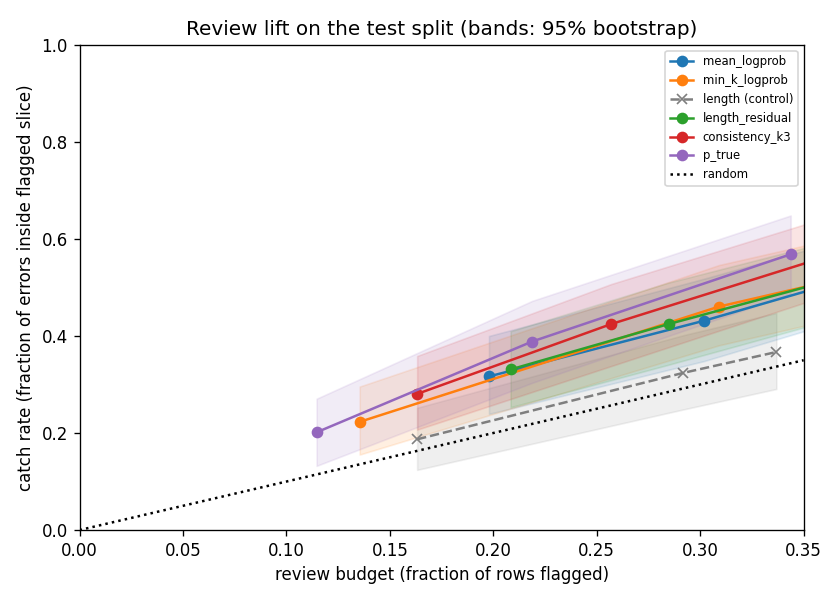
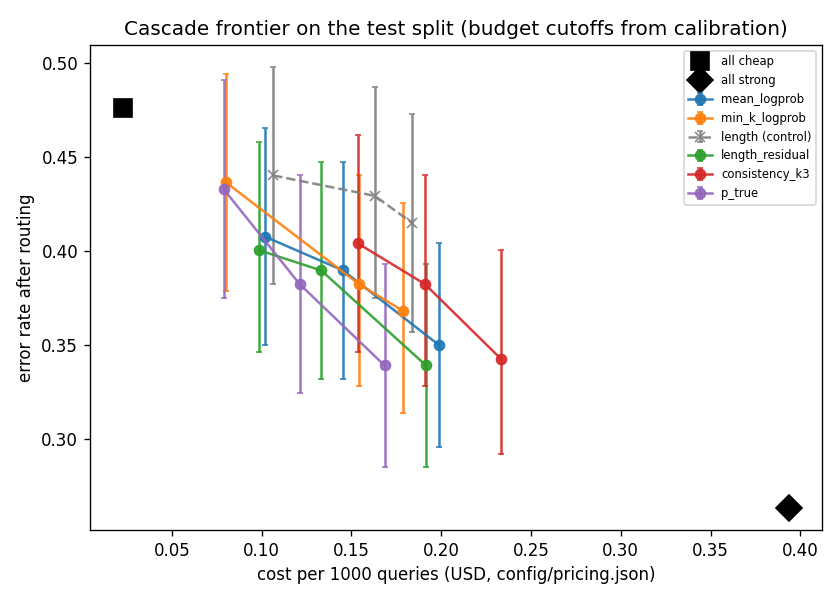
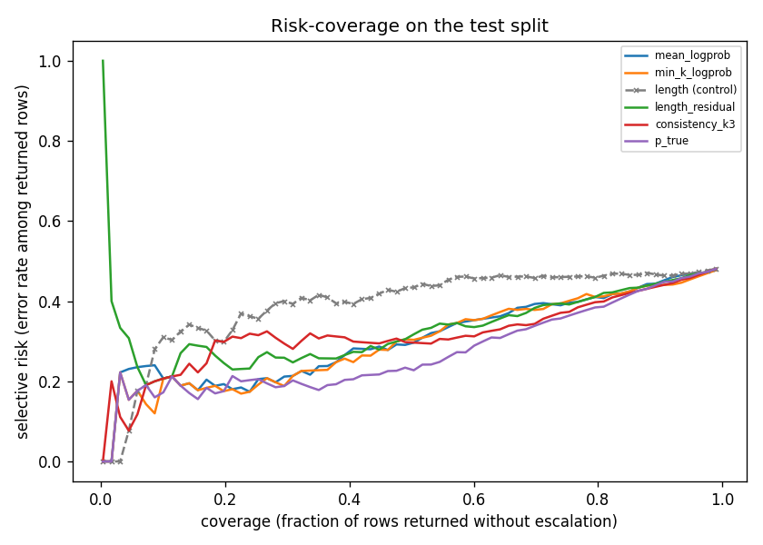

# Routing report

Prices from config/pricing.json (priced_on 2026-09-14). Brackets are 95 percent bootstrap intervals (2000 resamples, seed 42) or Wilson intervals for proportions. Raw counts carry no interval.

## Summary

On 288 test rows with a consensus label, the cheap model (gpt-4o-mini) has an error rate of 48.3% [42.6, 54.0]. The best scorer by lift at a 20 percent review budget is `p_true`, catching 38.8% [30.3, 47.2] of errors against 21.9% [17.5, 27.0] for random, a lift of 1.78 [1.56, 2.03]. Residual error among unreviewed rows at that budget is 37.8% [31.4, 44.0]. The cascade at the `p_true` budget 0.3 cutoff has error 33.9% [28.5, 39.4] at $0.17 [0.15, 0.19] per thousand queries, against all-cheap 47.7% [41.8, 53.5] at $0.02 [0.02, 0.02] and all-strong 26.4% [21.5, 31.8] at $0.39 [0.38, 0.41]. Every cutoff was computed on the 160-row calibration split and applied once to test.

## Data and labels

- Calibration: 160 rows with a consensus label (65 INCORRECT), 2 AMBIGUOUS excluded. Scores file hash 2071130b013df522, labels hash e76c9fcaed2edddf.
- Test: 300 questions, 288 with a consensus cheap-model label, 12 AMBIGUOUS excluded. Cascade uses the 277 rows where both models have a consensus label (23 excluded).
- Judges: `gpt-4o` and `gpt-4.1`, blind to every score, consensus rule in routing/data.py. Agreement and kappa in results/phase1_notes.md.

## Validity gates

See results/gates_test.md. Template rows: 0. Split disjoint: True. Power at actual n: 0.99.

| scorer | AUROC | vs length p | flag |
|---|---|---|---|
| consistency_k3 | 0.730 [0.668, 0.786] | 0.000 |  |
| length | 0.580 [0.517, 0.645] | n/a | control |
| length_residual | 0.721 [0.664, 0.782] | 0.001 |  |
| mean_logprob | 0.735 [0.679, 0.789] | 0.000 |  |
| min_k_logprob | 0.741 [0.685, 0.796] | 0.000 |  |
| p_true | 0.799 [0.750, 0.847] | 0.000 |  |

## Review lift



| scorer | budget | flagged | catch rate | random | lift | residual error |
|---|---:|---|---|---|---|---|
| mean_logprob | 0.10 | 19.8% [15.6, 24.8] | 31.7% [23.9, 40.0] | 19.8% [15.6, 24.8] | 1.60 [1.37, 1.84] | 41.1% [35.1, 47.4] |
| mean_logprob | 0.20 | 30.2% [25.2, 35.7] | 43.2% [34.8, 51.8] | 30.2% [25.2, 35.7] | 1.43 [1.26, 1.63] | 39.3% [32.5, 46.0] |
| mean_logprob | 0.30 | 43.1% [37.5, 48.8] | 59.0% [51.2, 67.2] | 43.1% [37.5, 48.8] | 1.37 [1.23, 1.53] | 34.8% [27.7, 42.0] |
| min_k_logprob | 0.10 | 13.5% [10.1, 18.0] | 22.3% [15.6, 29.6] | 13.5% [10.1, 18.0] | 1.65 [1.38, 1.93] | 43.4% [37.4, 49.6] |
| min_k_logprob | 0.20 | 30.9% [25.8, 36.5] | 46.0% [38.1, 54.6] | 30.9% [25.8, 36.5] | 1.49 [1.32, 1.69] | 37.7% [31.1, 44.1] |
| min_k_logprob | 0.30 | 37.5% [32.1, 43.2] | 52.5% [44.5, 61.0] | 37.5% [32.1, 43.2] | 1.40 [1.25, 1.57] | 36.7% [29.7, 43.8] |
| length | 0.10 | 16.3% [12.5, 21.0] | 18.7% [12.4, 25.2] | 16.3% [12.5, 21.0] | 1.15 [0.88, 1.41] | 46.9% [40.7, 52.9] |
| length | 0.20 | 29.2% [24.2, 34.7] | 32.4% [24.8, 40.1] | 29.2% [24.2, 34.7] | 1.11 [0.93, 1.30] | 46.1% [39.5, 52.6] |
| length | 0.30 | 33.7% [28.5, 39.3] | 36.7% [29.1, 44.7] | 33.7% [28.5, 39.3] | 1.09 [0.92, 1.26] | 46.1% [39.3, 52.7] |
| length_residual | 0.10 | 20.8% [16.5, 25.9] | 33.1% [25.3, 41.0] | 20.8% [16.5, 25.9] | 1.59 [1.37, 1.83] | 40.8% [34.5, 47.2] |
| length_residual | 0.20 | 28.5% [23.6, 33.9] | 42.4% [34.1, 51.0] | 28.5% [23.6, 33.9] | 1.49 [1.31, 1.70] | 38.8% [32.4, 45.7] |
| length_residual | 0.30 | 44.1% [38.5, 49.9] | 60.4% [52.4, 68.1] | 44.1% [38.5, 49.9] | 1.37 [1.24, 1.52] | 34.2% [27.0, 41.7] |
| consistency_k3 | 0.10 | 16.3% [12.5, 21.0] | 28.1% [20.7, 35.9] | 16.3% [12.5, 21.0] | 1.72 [1.48, 1.99] | 41.5% [35.5, 48.0] |
| consistency_k3 | 0.20 | 25.7% [21.0, 31.0] | 42.4% [33.8, 50.7] | 25.7% [21.0, 31.0] | 1.65 [1.45, 1.87] | 37.4% [31.1, 44.3] |
| consistency_k3 | 0.30 | 36.5% [31.1, 42.2] | 56.8% [48.8, 64.9] | 36.5% [31.1, 42.2] | 1.56 [1.39, 1.75] | 32.8% [26.1, 39.9] |
| p_true | 0.10 | 11.5% [8.3, 15.7] | 20.1% [13.2, 27.1] | 11.5% [8.3, 15.7] | 1.76 [1.49, 2.06] | 43.5% [37.5, 49.6] |
| p_true | 0.20 | 21.9% [17.5, 27.0] | 38.8% [30.3, 47.2] | 21.9% [17.5, 27.0] | 1.78 [1.56, 2.03] | 37.8% [31.4, 44.0] |
| p_true | 0.30 | 34.4% [29.1, 40.0] | 56.8% [48.6, 64.8] | 34.4% [29.1, 40.0] | 1.65 [1.48, 1.86] | 31.7% [25.4, 38.3] |

`*` marks a scorer not distinguishable from length. `length` is the control. Residual error is the error rate among unflagged rows, assuming review fixes what it finds.

## Cascade frontier



Endpoints: all cheap error 47.7% [41.8, 53.5] at $0.02 [0.02, 0.02] per 1000; all strong error 26.4% [21.5, 31.8] at $0.39 [0.38, 0.41] per 1000. The strong model's error rate is the ceiling of any cascade.

| scorer | cutoff | escalated | error | cost per 1000 | fix rate | break rate |
|---|---|---|---|---|---|---|
| mean_logprob | budget_0.1 | 18.8% [14.6, 23.8] | 40.8% [35.0, 46.6] | $0.10 [0.08, 0.13] | 48.8% [34.3, 63.5] | 9.1% [1.6, 37.7] |
| mean_logprob | budget_0.2 | 28.9% [23.9, 34.5] | 39.0% [33.2, 44.8] | $0.15 [0.12, 0.17] | 48.2% [35.7, 61.0] | 12.5% [4.3, 31.0] |
| mean_logprob | budget_0.3 | 41.5% [35.9, 47.4] | 35.0% [29.6, 40.4] | $0.20 [0.17, 0.23] | 50.6% [39.7, 61.5] | 10.5% [4.2, 24.1] |
| min_k_logprob | budget_0.1 | 13.0% [9.5, 17.5] | 43.7% [37.9, 49.5] | $0.08 [0.06, 0.10] | 41.4% [25.5, 59.3] | 14.3% [2.6, 51.3] |
| min_k_logprob | budget_0.2 | 30.0% [24.9, 35.6] | 38.3% [32.9, 44.0] | $0.15 [0.13, 0.18] | 49.2% [37.1, 61.4] | 18.2% [7.3, 38.5] |
| min_k_logprob | budget_0.3 | 35.7% [30.3, 41.5] | 36.8% [31.4, 42.6] | $0.18 [0.15, 0.21] | 50.0% [38.4, 61.6] | 12.9% [5.1, 28.9] |
| length | budget_0.1 | 15.9% [12.1, 20.7] | 44.0% [38.3, 49.8] | $0.11 [0.08, 0.13] | 45.8% [27.9, 64.9] | 5.0% [0.9, 23.6] |
| length | budget_0.2 | 28.9% [23.9, 34.5] | 43.0% [37.5, 48.7] | $0.16 [0.14, 0.19] | 42.9% [29.1, 57.8] | 13.2% [5.8, 27.3] |
| length | budget_0.3 | 33.2% [27.9, 39.0] | 41.5% [35.7, 47.3] | $0.18 [0.15, 0.22] | 46.8% [33.3, 60.8] | 11.1% [4.8, 23.5] |
| length_residual | budget_0.1 | 20.2% [15.9, 25.3] | 40.1% [34.6, 45.8] | $0.10 [0.08, 0.12] | 52.3% [37.9, 66.2] | 16.7% [4.7, 44.8] |
| length_residual | budget_0.2 | 27.1% [22.2, 32.6] | 39.0% [33.2, 44.8] | $0.13 [0.11, 0.16] | 47.3% [34.7, 60.2] | 10.0% [2.8, 30.1] |
| length_residual | budget_0.3 | 42.6% [36.9, 48.5] | 33.9% [28.5, 39.4] | $0.19 [0.17, 0.22] | 51.9% [41.1, 62.6] | 7.7% [2.7, 20.3] |
| consistency_k3 | budget_0.1 | 16.2% [12.4, 21.0] | 40.4% [34.7, 46.2] | $0.15 [0.14, 0.17] | 52.6% [37.3, 67.5] | 0.0% [0.0, 35.4] |
| consistency_k3 | budget_0.2 | 25.6% [20.8, 31.1] | 38.3% [32.9, 44.0] | $0.19 [0.17, 0.21] | 49.1% [36.6, 61.7] | 14.3% [4.0, 39.9] |
| consistency_k3 | budget_0.3 | 36.5% [31.0, 42.3] | 34.3% [29.2, 40.1] | $0.23 [0.21, 0.26] | 52.6% [41.6, 63.5] | 12.0% [4.2, 30.0] |
| p_true | budget_0.1 | 10.8% [7.7, 15.0] | 43.3% [37.5, 49.1] | $0.08 [0.06, 0.10] | 48.0% [30.0, 66.5] | 0.0% [0.0, 43.4] |
| p_true | budget_0.2 | 21.3% [16.9, 26.5] | 38.3% [32.5, 44.0] | $0.12 [0.10, 0.14] | 52.0% [38.5, 65.2] | 0.0% [0.0, 29.9] |
| p_true | budget_0.3 | 33.9% [28.6, 39.7] | 33.9% [28.5, 39.4] | $0.17 [0.15, 0.19] | 52.0% [40.9, 62.9] | 5.3% [0.9, 24.6] |

Fix rate: among escalated rows the cheap model got wrong, the fraction the strong model got right. Break rate: among escalated rows the cheap model got right, the fraction the strong model got wrong.

## Risk-coverage



| scorer | AURC | oracle AURC |
|---|---|---:|
| mean_logprob | 0.308 [0.244, 0.379] | 0.143 |
| min_k_logprob | 0.301 [0.241, 0.371] | 0.143 |
| length | 0.394 [0.328, 0.473] | 0.143 |
| length_residual | 0.337 [0.266, 0.413] | 0.143 |
| consistency_k3 | 0.318 [0.272, 0.421] | 0.143 |
| p_true | 0.276 [0.220, 0.353] | 0.143 |

## Length

Length tertile edges (output tokens): 22, 31. Rows per tertile: [86, 105, 97]. Lift at the 0.20 budget cutoff within each tertile.

| scorer | short | medium | long |
|---|---|---|---|
| mean_logprob | 1.64 [1.08, 2.30] (n=86, err=35) | 1.60 [1.28, 1.99] (n=105, err=53) | 1.20 [1.01, 1.41] (n=97, err=51) |
| min_k_logprob | 2.46 [1.95, 3.31] (n=86, err=35) | 1.60 [1.29, 1.99] (n=105, err=53) | 1.23 [1.08, 1.42] (n=97, err=51) |
| length | n/a (n=86, err=35) | n/a (n=105, err=53) | 1.02 [0.94, 1.10] (n=97, err=51) |
| length_residual | 1.54 [0.98, 2.18] (n=86, err=35) | 1.56 [1.26, 1.93] (n=105, err=53) | 1.35 [1.11, 1.63] (n=97, err=51) |
| consistency_k3 | 1.69 [1.15, 2.35] (n=86, err=35) | 1.56 [1.30, 1.91] (n=105, err=53) | 1.67 [1.38, 2.08] (n=97, err=51) |
| p_true | 2.23 [1.67, 2.97] (n=86, err=35) | 1.64 [1.31, 2.04] (n=105, err=53) | 1.64 [1.37, 2.01] (n=97, err=51) |

## Conformal and required n

Learn-Then-Test with a Hoeffding bound at delta 0.1, calibrated on n=160.

| scorer | alpha | threshold | coverage (cal) | coverage (test) | selective risk (test) |
|---|---:|---|---|---|---|
| mean_logprob | 0.05 | none qualifies | | | |
| mean_logprob | 0.1 | none qualifies | | | |
| mean_logprob | 0.2 | none qualifies | | | |
| min_k_logprob | 0.05 | none qualifies | | | |
| min_k_logprob | 0.1 | none qualifies | | | |
| min_k_logprob | 0.2 | none qualifies | | | |
| length | 0.05 | none qualifies | | | |
| length | 0.1 | none qualifies | | | |
| length | 0.2 | none qualifies | | | |
| length_residual | 0.05 | none qualifies | | | |
| length_residual | 0.1 | none qualifies | | | |
| length_residual | 0.2 | none qualifies | | | |
| consistency_k3 | 0.05 | none qualifies | | | |
| consistency_k3 | 0.1 | none qualifies | | | |
| consistency_k3 | 0.2 | none qualifies | | | |
| p_true | 0.05 | none qualifies | | | |
| p_true | 0.1 | none qualifies | | | |
| p_true | 0.2 | none qualifies | | | |

Required calibration size for a threshold to pass the test (n_acc = ln(1/delta) / (2 (alpha - risk_hat)^2), divided by target coverage):

| alpha | target coverage | n if risk_hat = 0 | n if risk_hat = alpha/2 |
|---:|---:|---:|---:|
| 0.05 | 0.5 | 922 | 3685 |
| 0.05 | 0.7 | 658 | 2632 |
| 0.05 | 0.9 | 512 | 2047 |
| 0.1 | 0.5 | 231 | 922 |
| 0.1 | 0.7 | 165 | 658 |
| 0.1 | 0.9 | 128 | 512 |
| 0.2 | 0.5 | 58 | 231 |
| 0.2 | 0.7 | 42 | 165 |
| 0.2 | 0.9 | 32 | 128 |

## Cost table

From results/calls.jsonl. Total calls 4620, total cost $1.5855.

| purpose | calls | input tokens | output tokens | USD |
|---|---:|---:|---:|---:|
| calibration:judge_a | 324 | 64057 | 10597 | 0.2661 |
| calibration:judge_b | 324 | 64057 | 9628 | 0.2051 |
| calibration:primary | 162 | 6758 | 4116 | 0.0035 |
| calibration:ptrue | 162 | 12641 | 192 | 0.0020 |
| calibration:resample_1 | 162 | 6758 | 4132 | 0.0035 |
| calibration:resample_2 | 162 | 6758 | 4123 | 0.0035 |
| calibration:resample_3 | 162 | 6758 | 4143 | 0.0035 |
| calibration:strong | 162 | 6758 | 4552 | 0.0624 |
| test:judge_a | 600 | 120198 | 19467 | 0.4952 |
| test:judge_b | 600 | 120198 | 18527 | 0.3886 |
| test:primary | 300 | 12580 | 8503 | 0.0070 |
| test:ptrue | 300 | 24358 | 362 | 0.0039 |
| test:resample_1 | 300 | 12580 | 8637 | 0.0071 |
| test:resample_2 | 300 | 12580 | 8524 | 0.0070 |
| test:resample_3 | 300 | 12580 | 8521 | 0.0070 |
| test:strong | 300 | 12580 | 8868 | 0.1201 |

## Limitations

- Short-answer QA (HaluEval) only. Long multi-claim outputs need claim-level scoring (ROADMAP.md).
- OpenAI models only for generation. Logprob scorers need a provider that returns logprobs; consistency and P(True) do not.
- Labels are from two LLM judges, not humans. AMBIGUOUS rows are excluded and counted above.
- Conformal thresholds are calibrated on 160 rows. The required-n table shows what a guarantee would need.
- Lift intervals are wide at n of a few hundred. Treat differences between scorers whose intervals overlap as unresolved.

## Reproduce

```bash
python -m routing.cli score --split calibration
python -m routing.cli score --split test
python -m routing.cli gates
python -m routing.cli calibrate
python -m routing.cli evaluate
```
