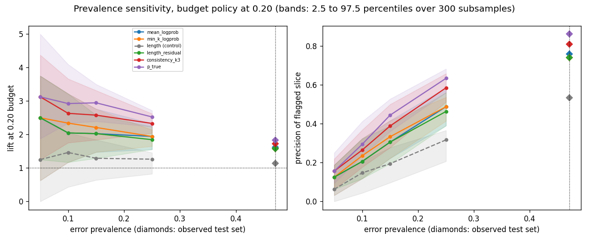

# Routing report

Prices from config/pricing.json (priced_on 2026-09-14). Brackets are 95 percent bootstrap intervals (2000 resamples, seed 42) or Wilson intervals for proportions. Raw counts carry no interval. Review lift, length strata and the cascade's budget points use the budget policy: the top ceil(budget * n) rows of the test batch by batch quantile, recomputed inside every bootstrap resample. Cascade risk points and the cutoff drift subsection use fixed cutoffs from results/calibration.json.

## Summary

On 287 test rows with a consensus label, the cheap model (gpt-4o-mini) has an error rate of 47.0% [41.3, 52.8]. Under the budget policy at 20 percent, the best scorer is `p_true`, catching 37.0% [32.4, 41.8] of errors against 20.2% [16.0, 25.2] for random, a lift of 1.83 [1.60, 2.07]; the best free scorer is `mean_logprob` at lift 1.61 [1.39, 1.86]. Residual error among unreviewed rows at that budget is 37.1% [30.6, 43.7] for `p_true`. The cascade at the `p_true` budget 0.3 point has error 33.2% [27.7, 39.1] at $0.16 [0.13, 0.18] per thousand queries, against all-cheap 46.4% [40.5, 52.3] at $0.02 [0.02, 0.02] and all-strong 24.8% [20.1, 30.3] at $0.39 [0.38, 0.41]. Fixed cutoffs from the 828-row calibration split are reported separately as risk-policy points and in the cutoff drift table.

## Data and labels

- Calibration: 828 rows with a consensus label (350 INCORRECT), 34 AMBIGUOUS excluded. Scores file hash 4136f21852a81217, labels hash 6e60789cc794ca81.
- Test: 300 questions, 287 with a consensus cheap-model label, 13 AMBIGUOUS excluded. Cascade uses the 274 rows where both models have a consensus label (26 excluded).
- Judges: `gpt-4.1-mini` and `gpt-4.1`, blind to every score, consensus rule in routing/data.py. Agreement and kappa in results/phase1_notes.md.

## Validity gates

See results/gates_test.md. Template rows: 0. Split disjoint: True. Power at actual n: 0.99.

| scorer | AUROC | vs length p | flag |
|---|---|---|---|
| consistency_k3 | 0.727 [0.664, 0.787] | 0.000 |  |
| length | 0.576 [0.508, 0.642] | n/a | control |
| length_residual | 0.712 [0.651, 0.769] | 0.003 |  |
| mean_logprob | 0.728 [0.668, 0.784] | 0.000 |  |
| min_k_logprob | 0.736 [0.677, 0.791] | 0.000 |  |
| p_true | 0.819 [0.770, 0.864] | 0.000 |  |

## Review lift

Budget policy: the top ceil(budget * n) rows of the test batch. Random-baseline catch rate equals the exact flagged fraction.


| scorer | budget | flagged | catch rate | random | lift | precision | residual error |
|---|---:|---|---|---|---|---|---|
| mean_logprob | 0.10 | 10.1% [7.1, 14.1] | 17.0% [13.0, 20.2] | 10.1% [7.1, 14.1] | 1.69 [1.28, 1.99] | 79.3% [61.6, 90.2] | 43.4% [37.2, 49.6] |
| mean_logprob | 0.20 | 20.2% [16.0, 25.2] | 32.6% [28.0, 37.6] | 20.2% [16.0, 25.2] | 1.61 [1.39, 1.86] | 75.9% [63.5, 85.0] | 39.7% [33.2, 46.3] |
| mean_logprob | 0.30 | 30.3% [25.3, 35.9] | 43.7% [38.2, 50.0] | 30.3% [25.3, 35.9] | 1.44 [1.26, 1.65] | 67.8% [57.4, 76.7] | 38.0% [31.5, 44.5] |
| min_k_logprob | 0.10 | 10.1% [7.1, 14.1] | 18.5% [14.7, 21.8] | 10.1% [7.1, 14.1] | 1.83 [1.45, 2.16] | 86.2% [69.4, 94.5] | 42.6% [36.8, 48.8] |
| min_k_logprob | 0.20 | 20.2% [16.0, 25.2] | 31.9% [26.8, 36.5] | 20.2% [16.0, 25.2] | 1.58 [1.33, 1.81] | 74.1% [61.6, 83.7] | 40.2% [34.5, 46.7] |
| min_k_logprob | 0.30 | 30.3% [25.3, 35.9] | 45.9% [39.1, 50.7] | 30.3% [25.3, 35.9] | 1.52 [1.29, 1.67] | 71.3% [61.0, 79.7] | 36.5% [31.0, 44.0] |
| length | 0.10 | 10.1% [7.1, 14.1] | 12.6% [8.8, 16.9] | 10.1% [7.1, 14.1] | 1.25 [0.87, 1.67] | 58.6% [40.7, 74.5] | 45.7% [39.5, 51.6] |
| length | 0.20 | 20.2% [16.0, 25.2] | 23.0% [18.0, 28.0] | 20.2% [16.0, 25.2] | 1.14 [0.89, 1.38] | 53.4% [40.8, 65.7] | 45.4% [38.9, 52.0] |
| length | 0.30 | 30.3% [25.3, 35.9] | 33.3% [27.3, 38.5] | 30.3% [25.3, 35.9] | 1.10 [0.90, 1.27] | 51.7% [41.4, 61.9] | 45.0% [38.5, 52.5] |
| length_residual | 0.10 | 10.1% [7.1, 14.1] | 17.0% [14.0, 21.1] | 10.1% [7.1, 14.1] | 1.69 [1.38, 2.08] | 79.3% [61.6, 90.2] | 43.4% [37.2, 49.2] |
| length_residual | 0.20 | 20.2% [16.0, 25.2] | 31.9% [26.4, 36.2] | 20.2% [16.0, 25.2] | 1.58 [1.31, 1.79] | 74.1% [61.6, 83.7] | 40.2% [34.1, 47.2] |
| length_residual | 0.30 | 30.3% [25.3, 35.9] | 43.7% [38.2, 50.4] | 30.3% [25.3, 35.9] | 1.44 [1.26, 1.66] | 67.8% [57.4, 76.7] | 38.0% [31.0, 45.5] |
| consistency_k3 | 0.10 | 10.1% [7.1, 14.1] | 18.5% [15.9, 22.0] | 10.1% [7.1, 14.1] | 1.83 [1.57, 2.17] | 86.2% [69.4, 94.5] | 42.6% [36.4, 48.4] |
| consistency_k3 | 0.20 | 20.2% [16.0, 25.2] | 34.8% [30.4, 40.2] | 20.2% [16.0, 25.2] | 1.72 [1.50, 1.99] | 81.0% [69.1, 89.1] | 38.4% [31.4, 45.0] |
| consistency_k3 | 0.30 | 30.3% [25.3, 35.9] | 51.1% [44.3, 56.0] | 30.3% [25.3, 35.9] | 1.69 [1.46, 1.85] | 79.3% [69.6, 86.5] | 33.0% [27.0, 40.5] |
| p_true | 0.10 | 10.1% [7.1, 14.1] | 18.5% [15.2, 21.8] | 10.1% [7.1, 14.1] | 1.83 [1.51, 2.16] | 86.2% [69.4, 94.5] | 42.6% [36.4, 49.2] |
| p_true | 0.20 | 20.2% [16.0, 25.2] | 37.0% [32.4, 41.8] | 20.2% [16.0, 25.2] | 1.83 [1.60, 2.07] | 86.2% [75.1, 92.8] | 37.1% [30.6, 43.7] |
| p_true | 0.30 | 30.3% [25.3, 35.9] | 52.6% [46.4, 58.5] | 30.3% [25.3, 35.9] | 1.73 [1.53, 1.93] | 81.6% [72.2, 88.4] | 32.0% [25.0, 39.5] |

`*` marks a scorer not distinguishable from length. `length` is the control. Precision is the fraction of flagged rows that are INCORRECT, which is what a reviewer sees. Residual error is the error rate among unflagged rows, assuming review fixes what it finds.


### Residual error against budget


Base error rate with no review: 47.0% [41.3, 52.8]. Budget policy from 0.05 to 0.50.

| scorer | 0.05 | 0.10 | 0.15 | 0.20 | 0.25 | 0.30 | 0.35 | 0.40 | 0.45 | 0.50 |
|---|---|---|---|---|---|---|---|---|---|---|
| mean_logprob | 46.0% [39.7, 51.5] | 43.4% [37.2, 49.6] | 40.7% [35.0, 47.7] | 39.7% [33.2, 46.3] | 37.7% [32.1, 45.1] | 38.0% [31.5, 44.5] | 36.6% [29.0, 44.1] | 34.3% [27.3, 41.9] | 31.8% [24.2, 40.8] | 28.7% [21.7, 37.8] |
| min_k_logprob | 44.1% [38.2, 50.4] | 42.6% [36.8, 48.8] | 41.2% [35.0, 47.7] | 40.2% [34.5, 46.7] | 39.1% [32.6, 45.6] | 36.5% [31.0, 44.0] | 36.6% [29.6, 43.5] | 34.3% [27.3, 42.4] | 31.2% [24.2, 40.1] | 29.4% [21.0, 37.1] |
| length | 46.0% [39.7, 51.8] | 45.7% [39.5, 51.6] | 45.7% [39.5, 51.9] | 45.4% [38.9, 52.0] | 45.1% [38.6, 52.1] | 45.0% [38.5, 52.5] | 44.1% [38.2, 52.2] | 45.3% [37.8, 52.9] | 43.9% [35.7, 52.2] | 43.4% [34.3, 51.0] |
| length_residual | 45.2% [39.3, 51.1] | 43.4% [37.2, 49.2] | 41.6% [35.4, 48.1] | 40.2% [34.1, 47.2] | 39.5% [33.0, 46.0] | 38.0% [31.0, 45.5] | 34.9% [28.0, 43.0] | 33.1% [26.7, 40.7] | 32.5% [24.8, 40.1] | 29.4% [23.1, 38.5] |
| consistency_k3 | 44.5% [38.6, 50.7] | 42.6% [36.4, 48.4] | 40.7% [34.2, 46.9] | 38.4% [31.4, 45.0] | 35.8% [29.3, 42.8] | 33.0% [27.0, 40.5] | 32.3% [25.8, 39.8] | 30.8% [23.8, 38.4] | 29.9% [22.9, 36.9] | 29.4% [22.4, 37.1] |
| p_true | 44.9% [38.6, 51.1] | 42.6% [36.4, 49.2] | 39.5% [32.9, 46.5] | 37.1% [30.6, 43.7] | 34.9% [28.4, 41.9] | 32.0% [25.0, 39.5] | 29.0% [22.6, 37.6] | 26.7% [19.8, 34.9] | 24.2% [17.2, 31.8] | 22.4% [15.4, 30.1] |

`p_true` reaches half the base error rate (23.5%) at a budget of 0.50, where residual error is 22.4% [15.4, 30.1].

### Cutoff drift

For each scorer and budget: the cutoff a calibration-derived quantile would give, the flag rate that fixed cutoff actually produces on test, and the batch-quantile cutoff the budget policy used on test instead. A cutoff fixed on one draw does not deliver a fixed flag rate on another, which is why budget policies use batch quantiles.

| scorer | budget | calibration cutoff | flag rate on test at that cutoff | batch cutoff on test |
|---|---:|---:|---|---:|
| mean_logprob | 0.10 | 0.1834 | 16.0% [12.2, 20.7] | 0.2059 |
| mean_logprob | 0.20 | 0.1355 | 27.2% [22.4, 32.6] | 0.1606 |
| mean_logprob | 0.30 | 0.1030 | 36.6% [31.2, 42.3] | 0.1246 |
| min_k_logprob | 0.10 | 0.8191 | 13.9% [10.4, 18.4] | 0.9426 |
| min_k_logprob | 0.20 | 0.6193 | 30.3% [25.3, 35.9] | 0.7263 |
| min_k_logprob | 0.30 | 0.4949 | 35.2% [29.9, 40.9] | 0.6204 |
| length | 0.10 | 42.0000 | 11.1% [8.0, 15.3] | 44.0000 |
| length | 0.20 | 35.0000 | 24.4% [19.8, 29.7] | 36.0000 |
| length | 0.30 | 31.0000 | 33.1% [27.9, 38.7] | 32.0000 |
| length_residual | 0.10 | 0.0906 | 14.6% [11.0, 19.2] | 0.1258 |
| length_residual | 0.20 | 0.0464 | 25.1% [20.4, 30.4] | 0.0659 |
| length_residual | 0.30 | 0.0191 | 35.9% [30.6, 41.6] | 0.0344 |
| consistency_k3 | 0.10 | 0.2108 | 13.9% [10.4, 18.4] | 0.2353 |
| consistency_k3 | 0.20 | 0.1465 | 24.0% [19.5, 29.3] | 0.1616 |
| consistency_k3 | 0.30 | 0.0867 | 36.6% [31.2, 42.3] | 0.1231 |
| p_true | 0.10 | 12.2500 | 9.1% [6.3, 12.9] | 12.0000 |
| p_true | 0.20 | 5.0000 | 21.3% [16.9, 26.4] | 5.7500 |
| p_true | 0.30 | 1.0000 | 33.8% [28.6, 39.5] | 2.2500 |

### Cost tiers

What each scorer costs per score beyond the primary answer, from logged tokens and config/pricing.json, and what it buys at the 0.20 budget. Sorted by extra cost.

| scorer | extra calls | extra cost per 1000 | lift at 0.20 |
|---|---:|---|---|
| length | 0 | $0.00 [0.00, 0.00] | 1.14 [0.89, 1.38] |
| length_residual | 0 | $0.00 [0.00, 0.00] | 1.58 [1.31, 1.79] |
| mean_logprob | 0 | $0.00 [0.00, 0.00] | 1.61 [1.39, 1.86] |
| min_k_logprob | 0 | $0.00 [0.00, 0.00] | 1.58 [1.33, 1.81] |
| p_true | 1 | $0.01 [0.01, 0.01] | 1.83 [1.60, 2.07] |
| consistency_k3 | 3 | $0.07 [0.07, 0.07] | 1.72 [1.50, 1.99] |

### Prevalence sensitivity

Every CORRECT test row is kept (152) and INCORRECT rows are subsampled without replacement to the target prevalence, 300 times (seeds 0 to 299). Cells are the median and the 2.5 and 97.5 percentiles across subsamples. These are subsample intervals, not row bootstraps. Budget policy at 0.20 inside each subsample. The observed test prevalence is 47.0%.



| scorer | prevalence | n | catch rate | lift | precision | residual error |
|---|---:|---:|---|---|---|---|
| mean_logprob | 0.05 | 160 | 50.0% [12.5, 75.0] | 2.50 [0.62, 3.75] | 12.5% [3.1, 18.8] | 3.1% [1.6, 5.5] |
| mean_logprob | 0.10 | 169 | 41.2% [23.5, 64.7] | 2.05 [1.17, 3.22] | 20.6% [11.8, 32.4] | 7.4% [4.4, 9.6] |
| mean_logprob | 0.15 | 179 | 40.7% [29.6, 55.6] | 2.03 [1.47, 2.76] | 30.6% [22.2, 41.7] | 11.2% [8.4, 13.3] |
| mean_logprob | 0.25 | 203 | 39.2% [31.4, 47.1] | 1.94 [1.55, 2.33] | 48.8% [39.0, 58.5] | 19.1% [16.7, 21.6] |
| min_k_logprob | 0.05 | 160 | 50.0% [12.5, 75.0] | 2.50 [0.62, 3.75] | 12.5% [3.1, 18.8] | 3.1% [1.6, 5.5] |
| min_k_logprob | 0.10 | 169 | 47.1% [23.5, 64.7] | 2.34 [1.17, 3.22] | 23.5% [11.8, 32.4] | 6.7% [4.4, 9.6] |
| min_k_logprob | 0.15 | 179 | 44.4% [29.6, 55.6] | 2.21 [1.47, 2.76] | 33.3% [22.2, 41.7] | 10.5% [8.4, 13.3] |
| min_k_logprob | 0.25 | 203 | 39.2% [33.3, 43.1] | 1.94 [1.65, 2.14] | 48.8% [41.5, 53.7] | 19.1% [17.9, 21.0] |
| length | 0.05 | 160 | 25.0% [0.0, 50.0] | 1.25 [0.00, 2.50] | 6.2% [0.0, 12.5] | 4.7% [3.1, 6.2] |
| length | 0.10 | 169 | 29.4% [8.7, 41.2] | 1.46 [0.43, 2.05] | 14.7% [4.3, 20.6] | 8.9% [7.4, 11.5] |
| length | 0.15 | 179 | 25.9% [12.9, 37.0] | 1.29 [0.64, 1.84] | 19.4% [9.7, 27.8] | 14.0% [11.9, 16.5] |
| length | 0.25 | 203 | 25.5% [16.6, 29.4] | 1.26 [0.82, 1.46] | 31.7% [20.7, 36.6] | 23.5% [22.2, 26.2] |
| length_residual | 0.05 | 160 | 50.0% [25.0, 75.0] | 2.50 [1.25, 3.75] | 12.5% [6.2, 18.8] | 3.1% [1.6, 4.7] |
| length_residual | 0.10 | 169 | 41.2% [23.5, 64.7] | 2.05 [1.17, 3.22] | 20.6% [11.8, 32.4] | 7.4% [4.4, 9.6] |
| length_residual | 0.15 | 179 | 40.7% [25.9, 51.9] | 2.03 [1.29, 2.58] | 30.6% [19.4, 38.9] | 11.2% [9.1, 14.0] |
| length_residual | 0.25 | 203 | 37.3% [31.4, 45.1] | 1.84 [1.55, 2.23] | 46.3% [39.0, 56.1] | 19.8% [17.3, 21.6] |
| consistency_k3 | 0.05 | 160 | 62.5% [25.0, 87.5] | 3.12 [1.25, 4.38] | 15.6% [6.2, 21.9] | 2.3% [0.8, 4.7] |
| consistency_k3 | 0.10 | 169 | 52.9% [35.3, 73.7] | 2.63 [1.75, 3.66] | 26.5% [17.6, 36.8] | 5.9% [3.3, 8.1] |
| consistency_k3 | 0.15 | 179 | 51.9% [37.0, 66.7] | 2.58 [1.84, 3.31] | 38.9% [27.8, 50.0] | 9.1% [6.3, 11.9] |
| consistency_k3 | 0.25 | 203 | 47.1% [41.2, 52.9] | 2.33 [2.04, 2.62] | 58.5% [51.2, 65.9] | 16.7% [14.8, 18.5] |
| p_true | 0.05 | 160 | 62.5% [37.5, 100.0] | 3.12 [1.88, 5.00] | 15.6% [9.4, 25.0] | 2.3% [0.0, 3.9] |
| p_true | 0.10 | 169 | 58.8% [47.1, 82.4] | 2.92 [2.34, 4.09] | 29.4% [23.5, 41.2] | 5.2% [2.2, 6.7] |
| p_true | 0.15 | 179 | 59.3% [48.1, 70.4] | 2.95 [2.39, 3.50] | 44.4% [36.1, 52.8] | 7.7% [5.6, 9.8] |
| p_true | 0.25 | 203 | 51.0% [45.1, 54.9] | 2.52 [2.23, 2.72] | 63.4% [56.1, 68.3] | 15.4% [14.2, 17.3] |

Lift for `p_true` is 2.52 [2.23, 2.72] at prevalence 0.25 and 3.12 [1.88, 5.00] at 0.05, so it holds above 1 across the whole range as prevalence falls. At 10 percent prevalence a reviewer working the flagged slice from `p_true` would see precision 29.4% [23.5, 41.2]: roughly 3 rows read per error found, against 10 at random.

## Cascade frontier


Endpoints: all cheap error 46.4% [40.5, 52.3] at $0.02 [0.02, 0.02] per 1000; all strong error 24.8% [20.1, 30.3] at $0.39 [0.38, 0.41] per 1000. The strong model's error rate is the ceiling of any cascade. Budget points (circles) escalate the top ceil(budget * n) rows of the batch; risk points (triangles) escalate rows at or above a fixed cutoff from results/calibration.json, so their escalated fraction floats.

| scorer | policy | point | cutoff | escalated | error | cost per 1000 | gap closed | cost fraction | fix rate | break rate |
|---|---|---|---:|---|---|---|---|---|---|---|
| mean_logprob | budget | budget_0.1 | 0.2048 | 10.2% [7.2, 14.4] | 42.0% [35.8, 47.8] | $0.06 [0.05, 0.07] | 20.3% [9.5, 32.2] | 9.8% [6.4, 13.8] | 59.1% [38.7, 76.7] | 16.7% [3.0, 56.4] |
| mean_logprob | budget | budget_0.2 | 0.1596 | 20.1% [15.8, 25.2] | 39.8% [33.9, 45.6] | $0.11 [0.09, 0.13] | 30.5% [17.4, 44.0] | 22.6% [17.3, 28.2] | 50.0% [35.2, 64.8] | 13.3% [3.7, 37.9] |
| mean_logprob | budget | budget_0.3 | 0.1222 | 30.3% [25.2, 36.0] | 37.6% [31.8, 43.4] | $0.15 [0.13, 0.18] | 40.7% [26.4, 55.0] | 34.6% [28.2, 40.9] | 49.1% [36.4, 61.9] | 10.7% [3.7, 27.2] |
| mean_logprob | risk | risk_calcut_0.1 | 0.1834 | 15.7% [11.9, 20.5] | 40.5% [34.7, 46.4] | $0.08 [0.07, 0.10] | 27.1% [15.4, 39.6] | 16.3% [11.8, 21.5] | 50.0% [34.1, 65.9] | 11.1% [2.0, 43.5] |
| mean_logprob | risk | risk_calcut_0.2 | 0.1355 | 25.9% [21.1, 31.4] | 38.3% [32.5, 44.2] | $0.13 [0.11, 0.15] | 37.3% [24.1, 51.2] | 29.0% [23.1, 35.1] | 49.0% [35.6, 62.5] | 9.1% [2.5, 27.8] |
| mean_logprob | risk | risk_calcut_0.3 | 0.1030 | 35.4% [30.0, 41.2] | 35.0% [29.6, 40.9] | $0.17 [0.15, 0.20] | 52.5% [38.2, 66.7] | 40.4% [33.8, 46.9] | 52.3% [40.4, 64.0] | 9.4% [3.2, 24.2] |
| mean_logprob | risk | risk_alpha_0.2 | 0.0138 | 92.3% [88.6, 94.9] | 26.3% [21.2, 31.8] | $0.39 [0.37, 0.41] | 93.2% [85.4, 98.5] | 99.3% [96.0, 102.1] | 50.8% [42.1, 59.5] | 5.3% [2.6, 10.6] |
| min_k_logprob | budget | budget_0.1 | 0.9311 | 10.2% [7.2, 14.4] | 42.7% [36.5, 48.5] | $0.07 [0.05, 0.09] | 16.9% [7.8, 27.6] | 12.1% [7.7, 17.0] | 43.5% [25.6, 63.2] | 0.0% [0.0, 43.4] |
| min_k_logprob | budget | budget_0.2 | 0.7196 | 20.1% [15.8, 25.2] | 41.2% [35.4, 47.1] | $0.11 [0.09, 0.14] | 23.7% [10.9, 36.4] | 23.8% [18.0, 29.7] | 44.7% [30.1, 60.3] | 17.6% [6.2, 41.0] |
| min_k_logprob | budget | budget_0.3 | 0.6142 | 30.3% [25.2, 36.0] | 37.2% [31.4, 43.1] | $0.15 [0.13, 0.18] | 42.4% [27.9, 56.7] | 35.5% [29.2, 41.9] | 50.9% [38.3, 63.4] | 15.4% [6.1, 33.5] |
| min_k_logprob | risk | risk_calcut_0.1 | 0.8191 | 13.5% [10.0, 18.1] | 42.3% [36.5, 48.2] | $0.08 [0.06, 0.10] | 18.6% [7.7, 30.8] | 15.8% [10.9, 21.1] | 41.4% [25.5, 59.3] | 12.5% [2.2, 47.1] |
| min_k_logprob | risk | risk_calcut_0.2 | 0.6193 | 29.9% [24.8, 35.6] | 37.2% [31.4, 43.1] | $0.15 [0.13, 0.18] | 42.4% [27.9, 56.7] | 35.1% [28.7, 41.6] | 50.9% [38.3, 63.4] | 16.0% [6.4, 34.7] |
| min_k_logprob | risk | risk_calcut_0.3 | 0.4949 | 34.3% [28.9, 40.1] | 36.5% [30.7, 42.3] | $0.17 [0.15, 0.20] | 45.8% [31.0, 60.0] | 40.7% [34.0, 47.1] | 50.8% [38.6, 62.9] | 12.1% [4.8, 27.3] |
| min_k_logprob | risk | risk_alpha_0.2 | 0.0611 | 92.7% [89.0, 95.2] | 25.5% [20.4, 30.7] | $0.39 [0.37, 0.42] | 96.6% [91.1, 100.0] | 100.1% [97.4, 102.7] | 51.6% [42.9, 60.2] | 5.4% [2.6, 10.7] |
| length | budget | budget_0.1 | 43.0000 | 10.2% [7.2, 14.4] | 43.8% [37.9, 49.6] | $0.08 [0.06, 0.10] | 11.9% [3.9, 21.6] | 15.4% [10.2, 20.9] | 46.7% [24.8, 69.9] | 0.0% [0.0, 22.8] |
| length | budget | budget_0.2 | 36.0000 | 20.1% [15.8, 25.2] | 43.1% [37.2, 48.9] | $0.12 [0.10, 0.15] | 15.3% [2.1, 27.8] | 27.2% [20.8, 33.4] | 46.4% [29.5, 64.2] | 14.8% [5.9, 32.5] |
| length | budget | budget_0.3 | 32.0000 | 30.3% [25.2, 36.0] | 40.9% [35.0, 46.7] | $0.17 [0.14, 0.20] | 25.4% [11.4, 39.7] | 39.3% [32.7, 45.8] | 50.0% [35.2, 64.8] | 11.6% [5.1, 24.5] |
| length | risk | risk_calcut_0.1 | 42.0000 | 10.6% [7.5, 14.8] | 43.8% [37.9, 49.6] | $0.08 [0.06, 0.10] | 11.9% [3.9, 21.6] | 15.9% [10.7, 21.4] | 46.7% [24.8, 69.9] | 0.0% [0.0, 21.5] |
| length | risk | risk_calcut_0.2 | 35.0000 | 24.1% [19.4, 29.5] | 42.0% [36.1, 47.8] | $0.14 [0.12, 0.17] | 20.3% [6.7, 33.9] | 32.4% [25.8, 38.7] | 48.5% [32.5, 64.8] | 12.1% [4.8, 27.3] |
| length | risk | risk_calcut_0.3 | 31.0000 | 32.8% [27.6, 38.6] | 40.1% [34.3, 46.0] | $0.18 [0.15, 0.21] | 28.8% [14.6, 43.1] | 42.8% [35.9, 49.6] | 51.2% [36.8, 65.4] | 10.6% [4.6, 22.6] |
| length_residual | budget | budget_0.1 | 0.1286 | 10.2% [7.2, 14.4] | 42.3% [36.5, 48.5] | $0.06 [0.04, 0.07] | 18.6% [8.1, 30.2] | 9.0% [5.9, 12.7] | 52.2% [33.0, 70.8] | 20.0% [3.6, 62.4] |
| length_residual | budget | budget_0.2 | 0.0659 | 20.1% [15.8, 25.2] | 38.7% [32.8, 44.9] | $0.10 [0.08, 0.12] | 35.6% [22.4, 50.0] | 19.7% [15.0, 24.9] | 56.1% [41.0, 70.1] | 14.3% [4.0, 39.9] |
| length_residual | budget | budget_0.3 | 0.0321 | 30.3% [25.2, 36.0] | 37.6% [31.8, 43.4] | $0.14 [0.12, 0.17] | 40.7% [26.4, 55.1] | 32.2% [26.3, 38.4] | 48.2% [35.7, 61.0] | 11.1% [3.9, 28.1] |
| length_residual | risk | risk_calcut_0.1 | 0.0906 | 15.3% [11.5, 20.1] | 40.5% [34.7, 46.4] | $0.08 [0.06, 0.10] | 27.1% [15.0, 39.3] | 14.7% [10.5, 19.5] | 53.1% [36.4, 69.1] | 10.0% [1.8, 40.4] |
| length_residual | risk | risk_calcut_0.2 | 0.0464 | 23.7% [19.1, 29.1] | 38.7% [32.8, 44.9] | $0.11 [0.09, 0.13] | 35.6% [22.4, 50.0] | 23.8% [18.6, 29.5] | 51.1% [37.0, 65.0] | 10.0% [2.8, 30.1] |
| length_residual | risk | risk_calcut_0.3 | 0.0191 | 35.0% [29.6, 40.9] | 35.4% [29.6, 41.2] | $0.16 [0.14, 0.19] | 50.8% [36.5, 65.6] | 37.5% [31.2, 44.0] | 50.0% [38.3, 61.7] | 10.0% [3.5, 25.6] |
| consistency_k3 | budget | budget_0.1 | 0.2304 | 10.2% [7.2, 14.4] | 41.6% [35.8, 47.4] | $0.13 [0.12, 0.15] | 22.0% [12.2, 33.3] | 28.9% [25.1, 33.0] | 52.0% [33.5, 70.0] | 0.0% [0.0, 56.2] |
| consistency_k3 | budget | budget_0.2 | 0.1608 | 20.1% [15.8, 25.2] | 38.0% [32.1, 43.8] | $0.17 [0.15, 0.19] | 39.0% [26.4, 52.1] | 39.1% [34.2, 44.5] | 50.0% [36.1, 63.9] | 0.0% [0.0, 29.9] |
| consistency_k3 | budget | budget_0.3 | 0.1198 | 30.3% [25.2, 36.0] | 33.9% [28.5, 39.8] | $0.21 [0.19, 0.23] | 57.6% [43.5, 71.7] | 50.3% [44.0, 56.5] | 54.5% [42.6, 66.0] | 11.8% [3.3, 34.3] |
| consistency_k3 | risk | risk_calcut_0.1 | 0.2108 | 13.5% [10.0, 18.1] | 40.1% [34.3, 46.4] | $0.14 [0.13, 0.16] | 28.8% [17.6, 41.3] | 32.4% [28.0, 37.1] | 53.1% [36.4, 69.1] | 0.0% [0.0, 43.4] |
| consistency_k3 | risk | risk_calcut_0.2 | 0.1465 | 23.4% [18.7, 28.7] | 36.9% [31.4, 42.7] | $0.18 [0.16, 0.20] | 44.1% [31.1, 58.5] | 42.4% [37.2, 48.0] | 50.9% [37.9, 63.9] | 9.1% [1.6, 37.7] |
| consistency_k3 | risk | risk_calcut_0.3 | 0.0867 | 35.8% [30.3, 41.6] | 33.2% [27.7, 38.7] | $0.23 [0.20, 0.25] | 61.0% [47.3, 75.0] | 55.6% [49.4, 62.0] | 53.4% [42.1, 64.4] | 12.0% [4.2, 30.0] |
| p_true | budget | budget_0.1 | 11.7500 | 10.2% [7.2, 14.4] | 41.6% [35.4, 47.8] | $0.08 [0.06, 0.09] | 22.0% [12.1, 34.0] | 14.3% [10.6, 18.7] | 54.2% [35.1, 72.1] | 0.0% [0.0, 49.0] |
| p_true | budget | budget_0.2 | 5.5000 | 20.1% [15.8, 25.2] | 37.2% [31.4, 43.1] | $0.12 [0.10, 0.14] | 42.4% [29.2, 57.4] | 25.1% [19.8, 30.4] | 53.2% [39.2, 66.7] | 0.0% [0.0, 32.4] |
| p_true | budget | budget_0.3 | 2.2500 | 30.3% [25.2, 36.0] | 33.2% [27.7, 39.1] | $0.16 [0.13, 0.18] | 61.0% [46.9, 77.1] | 35.7% [29.4, 41.8] | 53.7% [41.9, 65.1] | 0.0% [0.0, 19.4] |
| p_true | risk | risk_calcut_0.1 | 12.2500 | 8.8% [6.0, 12.7] | 42.7% [36.5, 48.5] | $0.07 [0.06, 0.09] | 16.9% [7.8, 28.3] | 12.7% [9.3, 16.8] | 50.0% [29.9, 70.1] | 0.0% [0.0, 49.0] |
| p_true | risk | risk_calcut_0.2 | 5.0000 | 20.4% [16.1, 25.6] | 36.9% [31.0, 42.3] | $0.12 [0.10, 0.14] | 44.1% [30.9, 59.1] | 25.4% [20.0, 30.7] | 54.2% [40.3, 67.4] | 0.0% [0.0, 32.4] |
| p_true | risk | risk_calcut_0.3 | 1.0000 | 33.6% [28.2, 39.4] | 32.5% [27.0, 38.3] | $0.17 [0.14, 0.19] | 64.4% [50.0, 79.6] | 38.7% [32.6, 45.2] | 53.4% [42.1, 64.4] | 5.3% [0.9, 24.6] |
| p_true | risk | risk_alpha_0.2 | -10.5000 | 54.0% [48.1, 59.8] | 28.8% [23.7, 34.3] | $0.25 [0.22, 0.27] | 81.4% [68.7, 94.4] | 60.7% [53.7, 67.5] | 50.0% [40.5, 59.5] | 6.5% [2.2, 17.5] |

Fix rate: among escalated rows the cheap model got wrong, the fraction the strong model got right. Break rate: among escalated rows the cheap model got right, the fraction the strong model got wrong. Gap closed: (error all cheap minus error at point) over (error all cheap minus error all strong). Cost fraction: (cost at point minus cost all cheap) over (cost all strong minus cost all cheap). Both bootstrapped jointly over rows. `risk_calcut_b` is the fixed cutoff that flagged the top b fraction on calibration; `risk_alpha_a` points appear only when calibrate_risk finds a threshold.

## Risk-coverage


| scorer | AURC | oracle AURC |
|---|---|---:|
| mean_logprob | 0.302 [0.238, 0.373] | 0.135 |
| min_k_logprob | 0.294 [0.232, 0.362] | 0.135 |
| length | 0.383 [0.315, 0.459] | 0.135 |
| length_residual | 0.331 [0.259, 0.405] | 0.135 |
| consistency_k3 | 0.344 [0.261, 0.410] | 0.135 |
| p_true | 0.232 [0.181, 0.293] | 0.135 |

## Length

Length tertile edges (output tokens): 22, 30. Rows per tertile: [89, 91, 107]. Budget-policy lift at 0.20 applied within each tertile.

| scorer | short | medium | long |
|---|---|---|---|
| mean_logprob | 1.41 [0.96, 2.14] (n=89, err=35) | 1.60 [1.25, 2.04] (n=91, err=45) | 1.50 [1.12, 1.87] (n=107, err=55) |
| min_k_logprob | 1.98 [1.43, 2.55] (n=89, err=35) | 1.49 [1.13, 1.96] (n=91, err=45) | 1.68 [1.28, 2.00] (n=107, err=55) |
| length | 1.41 [0.82, 2.01] (n=89, err=35) | 0.96 [0.39, 1.30] (n=91, err=45) | 1.33 [0.92, 1.68] (n=107, err=55) |
| length_residual | 1.41 [0.90, 2.10] (n=89, err=35) | 1.70 [1.25, 2.05] (n=91, err=45) | 1.41 [1.06, 1.79] (n=107, err=55) |
| consistency_k3 | 1.70 [1.20, 2.31] (n=89, err=35) | 1.49 [1.20, 1.99] (n=91, err=45) | 1.77 [1.49, 2.17] (n=107, err=55) |
| p_true | 2.26 [1.65, 2.80] (n=89, err=35) | 1.81 [1.37, 2.16] (n=91, err=45) | 1.68 [1.33, 2.08] (n=107, err=55) |

## Conformal and required n

Learn-Then-Test with a Hoeffding bound at delta 0.1, calibrated on n=828.

| scorer | alpha | threshold | coverage (cal) | coverage (test) | selective risk (test) |
|---|---:|---|---|---|---|
| mean_logprob | 0.05 | none qualifies | | | |
| mean_logprob | 0.1 | none qualifies | | | |
| mean_logprob | 0.2 | 0.0138 | 11.4% | 7.3% [4.8, 10.9] | 23.8% [10.6, 45.1] |
| min_k_logprob | 0.05 | none qualifies | | | |
| min_k_logprob | 0.1 | none qualifies | | | |
| min_k_logprob | 0.2 | 0.0611 | 14.1% | 7.0% [4.6, 10.5] | 15.0% [5.2, 36.0] |
| length | 0.05 | none qualifies | | | |
| length | 0.1 | none qualifies | | | |
| length | 0.2 | none qualifies | | | |
| length_residual | 0.05 | none qualifies | | | |
| length_residual | 0.1 | none qualifies | | | |
| length_residual | 0.2 | none qualifies | | | |
| consistency_k3 | 0.05 | none qualifies | | | |
| consistency_k3 | 0.1 | none qualifies | | | |
| consistency_k3 | 0.2 | none qualifies | | | |
| p_true | 0.05 | none qualifies | | | |
| p_true | 0.1 | none qualifies | | | |
| p_true | 0.2 | -10.5000 | 48.9% | 44.9% [39.3, 50.7] | 20.9% [14.8, 28.7] |

Required calibration size for a threshold to pass the test (n_acc = ln(1/delta) / (2 (alpha - risk_hat)^2), divided by target coverage):

| alpha | target coverage | n if risk_hat = 0 | n if risk_hat = alpha/2 |
|---:|---:|---:|---:|
| 0.05 | 0.5 | 922 | 3685 |
| 0.05 | 0.7 | 658 | 2632 |
| 0.05 | 0.9 | 512 | 2047 |
| 0.1 | 0.5 | 231 | 922 |
| 0.1 | 0.7 | 165 | 658 |
| 0.1 | 0.9 | 128 | 512 |
| 0.2 | 0.5 | 58 | 231 |
| 0.2 | 0.7 | 42 | 165 |
| 0.2 | 0.9 | 32 | 128 |

## Cost table

From results/calls.jsonl. Total calls 12544, total cost $3.1519.

| purpose | calls | input tokens | output tokens | USD |
|---|---:|---:|---:|---:|
| calibration:judge_a | 2048 | 407061 | 71318 | 0.5005 |
| calibration:judge_b | 1724 | 343004 | 51792 | 1.1003 |
| calibration:primary | 862 | 35786 | 22990 | 0.0192 |
| calibration:ptrue | 862 | 68173 | 997 | 0.0108 |
| calibration:resample_1 | 862 | 35786 | 23104 | 0.0192 |
| calibration:resample_2 | 862 | 35786 | 23485 | 0.0195 |
| calibration:resample_3 | 862 | 35786 | 23463 | 0.0194 |
| calibration:strong | 862 | 35786 | 25569 | 0.3452 |
| test:judge_a | 1200 | 240396 | 40623 | 0.5771 |
| test:judge_b | 600 | 120198 | 18527 | 0.3886 |
| test:primary | 300 | 12580 | 8503 | 0.0070 |
| test:ptrue | 300 | 24358 | 362 | 0.0039 |
| test:resample_1 | 300 | 12580 | 8637 | 0.0071 |
| test:resample_2 | 300 | 12580 | 8524 | 0.0070 |
| test:resample_3 | 300 | 12580 | 8521 | 0.0070 |
| test:strong | 300 | 12580 | 8868 | 0.1201 |

## Limitations

- Short-answer QA (HaluEval) only. Long multi-claim outputs need claim-level scoring (docs/ROADMAP.md).
- OpenAI models only for generation. Logprob scorers need a provider that returns logprobs; consistency and P(True) do not.
- Labels are from two LLM judges from one provider, not humans. AMBIGUOUS rows are excluded and counted above.
- Conformal thresholds are calibrated on 828 rows. The required-n table shows what a guarantee would need.
- Budget routing needs the whole batch to take a quantile. Streaming needs a running quantile with a warmup window (docs/ROADMAP.md).
- Lift intervals are wide at n of a few hundred. Treat differences between scorers whose intervals overlap as unresolved.

## Reproduce

```bash
python -m routing.cli score --split calibration
python -m routing.cli score --split test
python -m routing.cli gates
python -m routing.cli calibrate
python -m routing.cli evaluate
```
